# Architecture Calendrier Multi-Plateformes Révolutionnaire
## Assistant Rédactionnel - Conception Complète

---

## 🎯 Vue d'Ensemble Exécutive

Cette architecture transforme le calendrier de publication basique existant en un **système révolutionnaire de visualisation et planification multi-plateformes** avec des fonctionnalités avancées de visualisation, d'optimisation temporelle et d'interface utilisateur de nouvelle génération.

### Objectifs Stratégiques

- **🎨 Interface Révolutionnaire** : Visualisation multi-vues avec timeline interactive et densité adaptative
- **📊 Visualisation Unifiée** : Affichage simultané des 11 plateformes avec codage couleur intelligent
- **🤖 Intelligence Intégrée** : Suggestions automatiques et optimisation temporelle basée sur l'IA
- **⚡ Performance Optimisée** : Rendu virtualisé pour 10,000+ événements simultanés
- **🎯 UX Révolutionnaire** : Interactions gestuelles, drag & drop avancé, personnalisation complète

---

## 🏗️ Architecture Technique Globale

### Diagramme d'Architecture du Calendrier Avancé

```mermaid
graph TB
    subgraph "Interface Utilisateur Révolutionnaire"
        A[AdvancedCalendarContainer] --> B[CalendarViewManager]
        B --> C[MultiViewRenderer]
        C --> D[CalendarView]
        C --> E[TimelineView]
        C --> F[KanbanView]
        C --> G[HeatmapView]
        C --> H[GanttView]
        
        I[InteractionEngine] --> J[DragDropManager]
        I --> K[GestureHandler]
        I --> L[KeyboardShortcuts]
        
        M[VisualizationEngine] --> N[PlatformColorCoding]
        M --> O[DensityAdapter]
        M --> P[AnimationController]
    end
    
    subgraph "Services de Données Intelligents"
        Q[CalendarDataService] --> R[EventManager]
        Q --> S[CampaignOrchestrator]
        Q --> T[ConflictDetector]
        
        U[OptimizationEngine] --> V[MLPredictor]
        U --> W[TimeSlotAnalyzer]
        U --> X[AudienceInsights]
        
        Y[CacheManager] --> Z[VirtualizationCache]
        Y --> AA[MetricsCache]
        Y --> BB[PreferencesCache]
    end
    
    subgraph "Backend Étendu"
        CC[CalendarAPI] --> DD[EventCRUD]
        CC --> EE[CampaignAPI]
        CC --> FF[AnalyticsAPI]
        
        GG[RealtimeService] --> HH[WebSocketManager]
        GG --> II[NotificationEngine]
        GG --> JJ[CollaborationSync]
    end
    
    A --> Q
    Q --> CC
    U --> CC
    GG --> A
```



---

## 📱 Composants React Avancés

### 1. Conteneur Principal Révolutionnaire

```typescript
// src/components/calendar/AdvancedCalendarContainer.tsx
import React, { useState, useCallback, useMemo } from 'react';
import styled from 'styled-components';
import { motion, AnimatePresence } from 'framer-motion';
import { useVirtualizer } from '@tanstack/react-virtual';
import { useGesture } from '@use-gesture/react';

interface AdvancedCalendarContainerProps {
  events: CalendarEvent[];
  campaigns: Campaign[];
  platforms: Platform[];
  viewMode: CalendarViewMode;
  onEventCreate: (event: Partial<CalendarEvent>) => Promise<void>;
  onEventUpdate: (eventId: string, updates: Partial<CalendarEvent>) => Promise<void>;
  onEventDelete: (eventId: string) => Promise<void>;
  onCampaignCreate: (campaign: Partial<Campaign>) => Promise<void>;
  onOptimizeSchedule: (criteria: OptimizationCriteria) => Promise<OptimalSchedule>;
}

const CalendarContainer = styled(motion.div)`
  display: flex;
  flex-direction: column;
  height: 100vh;
  background: ${({ theme }) => theme.background.primary};
  position: relative;
  overflow: hidden;
`;

const CalendarHeader = styled.div`
  display: flex;
  justify-content: space-between;
  align-items: center;
  padding: 1.5rem 2rem;
  background: ${({ theme }) => theme.background.secondary};
  border-bottom: 1px solid ${({ theme }) => theme.border.primary};
  z-index: 100;
`;

const ViewControls = styled.div`
  display: flex;
  gap: 1rem;
  align-items: center;
`;

const PlatformFilters = styled.div`
  display: flex;
  gap: 0.5rem;
  flex-wrap: wrap;
`;

const CalendarContent = styled.div`
  flex: 1;
  position: relative;
  overflow: hidden;
`;

export const AdvancedCalendarContainer: React.FC<AdvancedCalendarContainerProps> = ({
  events,
  campaigns,
  platforms,
  viewMode,
  onEventCreate,
  onEventUpdate,
  onEventDelete,
  onCampaignCreate,
  onOptimizeSchedule
}) => {
  const [selectedPlatforms, setSelectedPlatforms] = useState<Platform[]>(platforms);
  const [dateRange, setDateRange] = useState({
    start: new Date(),
    end: new Date(Date.now() + 30 * 24 * 60 * 60 * 1000) // 30 jours
  });
  const [density, setDensity] = useState<'compact' | 'comfortable' | 'spacious'>('comfortable');
  const [showOptimizationSuggestions, setShowOptimizationSuggestions] = useState(false);

  // Filtrage intelligent des événements
  const filteredEvents = useMemo(() => {
    return events.filter(event => {
      const platformMatch = selectedPlatforms.length === 0 || 
        selectedPlatforms.includes(event.platform);
      const dateMatch = event.scheduledDate >= dateRange.start && 
        event.scheduledDate <= dateRange.end;
      return platformMatch && dateMatch;
    });
  }, [events, selectedPlatforms, dateRange]);

  // Gestionnaire de gestures tactiles
  const bind = useGesture({
    onPinch: ({ offset: [scale] }) => {
      // Zoom intelligent basé sur le pinch
      if (scale > 1.2) {
        setDensity('spacious');
      } else if (scale < 0.8) {
        setDensity('compact');
      } else {
        setDensity('comfortable');
      }
    },
    onDrag: ({ movement: [mx, my], dragging }) => {
      // Navigation par glissement
      if (Math.abs(mx) > Math.abs(my) && Math.abs(mx) > 100) {
        const direction = mx > 0 ? -1 : 1;
        navigateTimeRange(direction);
      }
    }
  });

  const navigateTimeRange = useCallback((direction: number) => {
    const days = viewMode === 'day' ? 1 : viewMode === 'week' ? 7 : 30;
    const offset = days * direction * 24 * 60 * 60 * 1000;
    
    setDateRange(prev => ({
      start: new Date(prev.start.getTime() + offset),
      end: new Date(prev.end.getTime() + offset)
    }));
  }, [viewMode]);

  const handleOptimizeSchedule = useCallback(async () => {
    const criteria: OptimizationCriteria = {
      platforms: selectedPlatforms,
      timeRange: dateRange,
      objectives: ['engagement', 'reach'],
      constraints: {
        minInterval: 30, // minutes
        maxPerDay: 5,
        preferredHours: [9, 12, 15, 18, 21]
      }
    };

    const suggestions = await onOptimizeSchedule(criteria);
    setShowOptimizationSuggestions(true);
  }, [selectedPlatforms, dateRange, onOptimizeSchedule]);

  return (
    <CalendarContainer
      {...bind()}
      initial={{ opacity: 0, y: 20 }}
      animate={{ opacity: 1, y: 0 }}
      transition={{ duration: 0.5 }}
    >
      <CalendarHeader>
        <ViewControls>
          <ViewModeSelector 
            currentMode={viewMode}
            onModeChange={setViewMode}
          />
          <DensitySelector
            currentDensity={density}
            onDensityChange={setDensity}
          />
          <TimeRangeNavigator
            dateRange={dateRange}
            onRangeChange={setDateRange}
            onNavigate={navigateTimeRange}
          />
        </ViewControls>

        <PlatformFilters>
          <PlatformFilterChips
            platforms={platforms}
            selected={selectedPlatforms}
            onSelectionChange={setSelectedPlatforms}
          />
        </PlatformFilters>

        <ActionControls>
          <Button
            variant="outline"
            onClick={handleOptimizeSchedule}
            icon="🎯"
          >
            Optimiser
          </Button>
          <Button
            variant="primary"
            onClick={() => onEventCreate({})}
            icon="➕"
          >
            Nouveau
          </Button>
        </ActionControls>
      </CalendarHeader>

      <CalendarContent>
        <CalendarViewRenderer
          viewMode={viewMode}
          events={filteredEvents}
          campaigns={campaigns}
          density={density}
          dateRange={dateRange}
          selectedPlatforms={selectedPlatforms}
          onEventCreate={onEventCreate}
          onEventUpdate={onEventUpdate}
          onEventDelete={onEventDelete}
        />
      </CalendarContent>

      <AnimatePresence>
        {showOptimizationSuggestions && (
          <OptimizationSuggestionsModal
            onClose={() => setShowOptimizationSuggestions(false)}
          />
        )}
      </AnimatePresence>
    </CalendarContainer>
  );
};
```

### 2. Moteur de Rendu Multi-Vues

```typescript
// src/components/calendar/CalendarViewRenderer.tsx
import React, { useMemo } from 'react';
import { CalendarView } from './views/CalendarView';
import { TimelineView } from './views/TimelineView';
import { KanbanView } from './views/KanbanView';
import { HeatmapView } from './views/HeatmapView';
import { GanttView } from './views/GanttView';

interface CalendarViewRendererProps {
  viewMode: CalendarViewMode;
  events: CalendarEvent[];
  campaigns: Campaign[];
  density: 'compact' | 'comfortable' | 'spacious';
  dateRange: { start: Date; end: Date };
  selectedPlatforms: Platform[];
  onEventCreate: (event: Partial<CalendarEvent>) => Promise<void>;
  onEventUpdate: (eventId: string, updates: Partial<CalendarEvent>) => Promise<void>;
  onEventDelete: (eventId: string) => Promise<void>;
}

export const CalendarViewRenderer: React.FC<CalendarViewRendererProps> = ({
  viewMode,
  events,
  campaigns,
  density,
  dateRange,
  selectedPlatforms,
  onEventCreate,
  onEventUpdate,
  onEventDelete
}) => {
  // Optimisation des données pour chaque vue
  const viewData = useMemo(() => {
    return {
      events: events.map(event => ({
        ...event,
        platformColor: PLATFORM_COLORS[event.platform],
        densityHeight: DENSITY_HEIGHTS[density],
        conflictLevel: calculateConflictLevel(event, events)
      })),
      campaigns: campaigns.map(campaign => ({
        ...campaign,
        progress: calculateCampaignProgress(campaign, events),
        platformDistribution: calculatePlatformDistribution(campaign, events)
      }))
    };
  }, [events, campaigns, density]);

  const commonProps = {
    events: viewData.events,
    campaigns: viewData.campaigns,
    density,
    dateRange,
    selectedPlatforms,
    onEventCreate,
    onEventUpdate,
    onEventDelete
  };

  switch (viewMode) {
    case 'calendar':
      return <CalendarView {...commonProps} />;
    
    case 'timeline':
      return <TimelineView {...commonProps} />;
    
    case 'kanban':
      return <KanbanView {...commonProps} />;
    
    case 'heatmap':
      return <HeatmapView {...commonProps} />;
    
    case 'gantt':
      return <GanttView {...commonProps} />;
    
    default:
      return <CalendarView {...commonProps} />;
  }
};

// Constantes pour l'optimisation visuelle
const PLATFORM_COLORS = {
  instagram: '#E4405F',
  tiktok: '#000000',
  twitter: '#1DA1F2',
  facebook: '#1877F2',
  linkedin: '#0A66C2',
  youtube: '#FF0000',
  wordpress: '#21759B',
  medium: '#00AB6C',
  mailchimp: '#FFE01B',
  slack: '#4A154B',
  discord: '#5865F2'
};

const DENSITY_HEIGHTS = {
  compact: 60,
  comfortable: 80,
  spacious: 120
};
```

### 3. Vue Calendrier Avancée avec Virtualisation

```typescript
// src/components/calendar/views/CalendarView.tsx
import React, { useMemo, useCallback } from 'react';
import styled from 'styled-components';
import { motion } from 'framer-motion';
import { useVirtualizer } from '@tanstack/react-virtual';
import { useDrag, useDrop } from 'react-dnd';

const CalendarGrid = styled.div<{ density: string }>`
  display: grid;
  grid-template-columns: repeat(7, 1fr);
  height: 100%;
  overflow: auto;
  background: ${({ theme }) => theme.background.primary};
`;

const DayColumn = styled.div`
  border-right: 1px solid ${({ theme }) => theme.border.primary};
  position: relative;
  min-height: 100vh;
`;

const DayHeader = styled.div<{ isToday: boolean }>`
  padding: 1rem;
  text-align: center;
  font-weight: 600;
  background: ${({ theme, isToday }) => 
    isToday ? theme.colors.primary[50] : theme.background.secondary};
  border-bottom: 1px solid ${({ theme }) => theme.border.primary};
  position: sticky;
  top: 0;
  z-index: 10;
`;

const EventsContainer = styled.div`
  padding: 0.5rem;
  min-height: calc(100vh - 80px);
`;

const EventCard = styled(motion.div)<{ 
  platform: Platform; 
  conflictLevel: number;
  density: string;
}>`
  background: ${({ platform }) => PLATFORM_COLORS[platform]}15;
  border-left: 4px solid ${({ platform }) => PLATFORM_COLORS[platform]};
  border-radius: 0.5rem;
  padding: ${({ density }) => 
    density === 'compact' ? '0.5rem' : 
    density === 'comfortable' ? '0.75rem' : '1rem'};
  margin-bottom: 0.5rem;
  cursor: pointer;
  position: relative;
  
  ${({ conflictLevel }) => conflictLevel > 0 && `
    box-shadow: 0 0 0 2px #f59e0b;
    &::after {
      content: '⚠️';
      position: absolute;
      top: 0.25rem;
      right: 0.25rem;
      font-size: 0.75rem;
    }
  `}
  
  &:hover {
    transform: translateY(-2px);
    box-shadow: 0 4px 12px rgba(0, 0, 0, 0.15);
  }
`;

const DropZone = styled.div<{ isOver: boolean }>`
  min-height: 60px;
  border: 2px dashed ${({ theme, isOver }) => 
    isOver ? theme.colors.primary[500] : 'transparent'};
  border-radius: 0.5rem;
  display: flex;
  align-items: center;
  justify-content: center;
  color: ${({ theme }) => theme.text.tertiary};
  font-size: 0.875rem;
  margin: 0.5rem 0;
  
  ${({ isOver }) => isOver && `
    background: rgba(59, 130, 246, 0.05);
    color: #3b82f6;
  `}
`;

export const CalendarView: React.FC<CalendarViewProps> = ({
  events,
  campaigns,
  density,
  dateRange,
  selectedPlatforms,
  onEventCreate,
  onEventUpdate,
  onEventDelete
}) => {
  // Génération des jours de la période
  const days = useMemo(() => {
    const daysList = [];
    const current = new Date(dateRange.start);
    
    while (current <= dateRange.end) {
      daysList.push(new Date(current));
      current.setDate(current.getDate() + 1);
    }
    
    return daysList;
  }, [dateRange]);

  // Groupement des événements par jour
  const eventsByDay = useMemo(() => {
    const grouped = new Map<string, CalendarEvent[]>();
    
    events.forEach(event => {
      const dayKey = event.scheduledDate.toDateString();
      if (!grouped.has(dayKey)) {
        grouped.set(dayKey, []);
      }
      grouped.get(dayKey)!.push(event);
    });
    
    return grouped;
  }, [events]);

  // Virtualisation pour les performances
  const parentRef = React.useRef<HTMLDivElement>(null);
  const virtualizer = useVirtualizer({
    count: Math.ceil(days.length / 7), // Nombre de semaines
    getScrollElement: () => parentRef.current,
    estimateSize: () => 200 * (density === 'compact' ? 0.8 : density === 'spacious' ? 1.2 : 1),
    overscan: 2
  });

  const handleEventDrop = useCallback(async (
    eventId: string, 
    newDate: Date, 
    newPlatform?: Platform
  ) => {
    const updates: Partial<CalendarEvent> = {
      scheduledDate: newDate
    };
    
    if (newPlatform) {
      updates.platform = newPlatform;
    }
    
    await onEventUpdate(eventId, updates);
  }, [onEventUpdate]);

  return (
    <CalendarGrid density={density} ref={parentRef}>
      {days.map((day, index) => {
        const dayKey = day.toDateString();
        const dayEvents = eventsByDay.get(dayKey) || [];
        const isToday = day.toDateString() === new Date().toDateString();
        
        return (
          <DayColumn key={dayKey}>
            <DayHeader isToday={isToday}>
              <div>{day.getDate()}</div>
              <div style={{ fontSize: '0.75rem', opacity: 0.7 }}>
                {day.toLocaleDateString('fr-FR', { weekday: 'short' })}
              </div>
            </DayHeader>
            
            <EventsContainer>
              <DayDropZone
                day={day}
                onEventDrop={handleEventDrop}
                onEventCreate={onEventCreate}
              />
              
              {dayEvents.map(event => (
                <DraggableEventCard
                  key={event.id}
                  event={event}
                  density={density}
                  onUpdate={onEventUpdate}
                  onDelete={onEventDelete}
                />
              ))}
            </EventsContainer>
          </DayColumn>
        );
      })}
    </CalendarGrid>
  );
};

// Composant de carte d'événement draggable
const DraggableEventCard: React.FC<{
  event: CalendarEvent;
  density: string;
  onUpdate: (eventId: string, updates: Partial<CalendarEvent>) => Promise<void>;
  onDelete: (eventId: string) => Promise<void>;
}> = ({ event, density, onUpdate, onDelete }) => {
  const [{ isDragging }, drag] = useDrag({
    type: 'event',
    item: { id: event.id, event },
    collect: (monitor) => ({
      isDragging: monitor.isDragging()
    })
  });

  return (
    <EventCard
      ref={drag}
      platform={event.platform}
      conflictLevel={event.conflictLevel}
      density={density}
      style={{ opacity: isDragging ? 0.5 : 1 }}
      whileHover={{ scale: 1.02 }}
      whileTap={{ scale: 0.98 }}
    >
      <EventContent event={event} density={density} />
      <EventActions
        event={event}
        onUpdate={onUpdate}
        onDelete={onDelete}
      />
    </EventCard>
  );
};

// Zone de drop pour créer de nouveaux événements
const DayDropZone: React.FC<{
  day: Date;
  onEventDrop: (eventId: string, newDate: Date) => Promise<void>;
  onEventCreate: (event: Partial<CalendarEvent>) => Promise<void>;
}> = ({ day, onEventDrop, onEventCreate }) => {
  const [{ isOver }, drop] = useDrop({
    accept: 'event',
    drop: (item: { id: string; event: CalendarEvent }) => {
      onEventDrop(item.id, day);
    },
    collect: (monitor) => ({
      isOver: monitor.isOver()
    })
  });

  const handleCreateEvent = useCallback(() => {
    onEventCreate({
      scheduledDate: day,
      platform: 'instagram', // Plateforme par défaut
      status: 'draft'
    });
  }, [day, onEventCreate]);

  return (
    <DropZone ref={drop} isOver={isOver} onClick={handleCreateEvent}>
      {isOver ? 'Déposer ici' : '+ Ajouter un événement'}
    </DropZone>
  );
};
```

### 4. Vue Timeline Interactive

```typescript
// src/components/calendar/views/TimelineView.tsx
import React, { useMemo, useCallback, useRef } from 'react';
import styled from 'styled-components';
import { motion } from 'framer-motion';
import { useGesture } from '@use-gesture/react';

const TimelineContainer = styled.div`
  display: flex;
  flex-direction: column;
  height: 100%;
  overflow: hidden;
`;

const TimelineHeader = styled.div`
  display: flex;
  background: ${({ theme }) => theme.background.secondary};
  border-bottom: 1px solid ${({ theme }) => theme.border.primary};
  position: sticky;
  top: 0;
  z-index: 100;
`;

const PlatformColumn = styled.div`
  width: 200px;
  padding: 1rem;
  font-weight: 600;
  border-right: 1px solid ${({ theme }) => theme.border.primary};
  display: flex;
  align-items: center;
  gap: 0.5rem;
`;

const TimeScale = styled.div`
  flex: 1;
  display: flex;
  position: relative;
  overflow-x: auto;
`;

const TimelineContent = styled.div`
  flex: 1;
  display: flex;
  overflow: auto;
`;

const PlatformRow = styled.div<{ platform: Platform }>`
  width: 200px;
  padding: 1rem;
  border-right: 1px solid ${({ theme }) => theme.border.primary};
  border-bottom: 1px solid ${({ theme }) => theme.border.primary};
  background: ${({ platform }) => `${PLATFORM_COLORS[platform]}05`};
  display: flex;
  align-items: center;
  gap: 0.5rem;
`;

const EventsTrack = styled.div`
  flex: 1;
  position: relative;
  border-bottom: 1px solid ${({ theme }) => theme.border.primary};
  min-height: 80px;
`;

const TimelineEvent = styled(motion.div)<{
  platform: Platform;
  startPosition: number;
  duration: number;
  conflictLevel: number;
}>`
  position: absolute;
  left: ${({ startPosition }) => startPosition}px;
  width: ${({ duration }) => Math.max(duration, 60)}px;
  height: 60px;
  background: ${({ platform }) => PLATFORM_COLORS[platform]};
  border-radius: 0.5rem;
  padding: 0.5rem;
  color: white;
  font-size: 0.75rem;
  cursor: pointer;
  top: 50%;
  transform: translateY(-50%);
  
  ${({ conflictLevel }) => conflictLevel > 0 && `
    box-shadow: 0 0 0 2px #f59e0b;
    z-index: 10;
  `}
  
  &:hover {
    transform: translateY(-50%) scale(1.05);
    z-index: 20;
  }
`;

const TimeMarker = styled.div<{ position: number }>`
  position: absolute;
  left: ${({ position }) => position}px;
  top: 0;
  bottom: 0;
  width: 1px;
  background: ${({ theme }) => theme.border.secondary};
  
  &::before {
    content: attr(data-time);
    position: absolute;
    top: -30px;
    left: -20px;
    font-size: 0.75rem;
    color: ${({ theme }) => theme.text.tertiary};
    width: 40px;
    text-align: center;
  }
`;

export const TimelineView: React.FC<TimelineViewProps> = ({
  events,
  campaigns,
  density,
  dateRange,
  selectedPlatforms,
  onEventCreate,
  onEventUpdate,
  onEventDelete
}) => {
  const containerRef = useRef<HTMLDivElement>(null);
  const [zoom, setZoom] = useState(1);
  const [scrollPosition, setScrollPosition] = useState(0);

  // Calcul des positions temporelles
  const timelineData = useMemo(() => {
    const startTime = dateRange.start.getTime();
    const endTime = dateRange.end.getTime();
    const totalDuration = endTime - startTime;
    const pixelsPerMs = (1000 * zoom) / totalDuration; // Pixels par milliseconde

    // Génération des marqueurs temporels
    const timeMarkers = [];
    const interval = 60 * 60 * 1000; // 1 heure
    for (let time = startTime; time <= endTime; time += interval) {
      timeMarkers.push({
        time: new Date(time),
        position: (time - startTime) * pixelsPerMs
      });
    }

    // Positionnement des événements
    const positionedEvents = events.map(event => {
      const eventStart = event.scheduledDate.getTime();
      const position = (eventStart - startTime) * pixelsPerMs;
      const duration = 60 * 60 * 1000; // 1 heure par défaut
      const width = duration * pixelsPerMs;

      return {
        ...event,
        startPosition: position,
        duration: width,
        conflictLevel: calculateTimelineConflicts(event, events)
      };
    });

    return {
      timeMarkers,
      events: positionedEvents,
      totalWidth: totalDuration * pixelsPerMs
    };
  }, [events, dateRange, zoom]);

  // Gestionnaire de zoom et pan
  const bind = useGesture({
    onWheel: ({ delta: [, dy], ctrlKey }) => {
      if (ctrlKey) {
        // Zoom avec Ctrl + molette
        const zoomFactor = dy > 0 ? 0.9 : 1.1;
        setZoom(prev => Math.max(0.1, Math.min(5, prev * zoomFactor)));
      } else {
        // Scroll horizontal
        setScrollPosition(prev => 
          Math.max(0, Math.min(timelineData.totalWidth - 1000, prev + dy))
        );
      }
    },
    onDrag: ({ movement: [mx], dragging }) => {
      if (dragging) {
        setScrollPosition(prev => 
          Math.max(0, Math.min(timelineData.totalWidth - 1000, prev - mx))
        );
      }
    }
  });

  const handleEventDrop = useCallback(async (
    eventId: string,
    newPosition: number
  ) => {
    const startTime = dateRange.start.getTime();
    const pixelsPerMs = (1000 * zoom) / (dateRange.end.getTime() - startTime);
    const newTime = startTime + (newPosition / pixelsPerMs);
    
    await onEventUpdate(eventId, {
      scheduledDate: new Date(newTime)
    });
  }, [dateRange, zoom, onEventUpdate]);

  return (
    <TimelineContainer {...bind()} ref={containerRef}>
      <TimelineHeader>
        <PlatformColumn>Plateformes</PlatformColumn>
        <TimeScale style={{ transform: `translateX(-${scrollPosition}px)` }}>
          {timelineData.timeMarkers.map(marker => (
            <TimeMarker
              key={marker.time.getTime()}
              position={marker.position}
              data-time={marker.time.toLocaleTimeString('fr-FR', { 
                hour: '2-digit', 
                minute: '2-digit' 
              })}
            />
          ))}
        </TimeScale>
      </TimelineHeader>

      <TimelineContent>
        <div>
          {selectedPlatforms.map(platform => (
            <PlatformRow key={platform} platform={platform}>
              <span style={{ color: PLATFORM_COLORS[platform] }}>
                {PLATFORM_METADATA[platform].icon}
              </span>
              {PLATFORM_METADATA[platform].name}
            </PlatformRow>
          ))}
        </div>

        <div style={{ flex: 1, position: