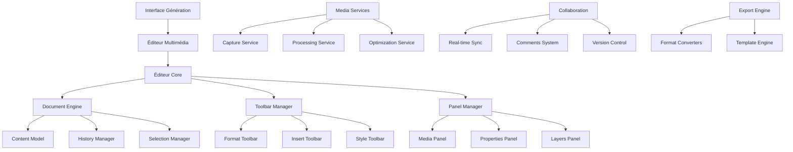

# Architecture Éditeur Multimédia Avancé - COMPLÈTE
## Assistant Rédactionnel - Révolution de l'Édition de Contenu

### 🎯 Vue d'ensemble Exécutive

Cette architecture définit l'éditeur multimédia révolutionnaire pour l'Assistant Rédactionnel, conçu comme un module d'amélioration post-génération qui transforme les textes générés par l'IA en contenus multimédias riches et interactifs.

---

## 📋 Analyse de l'Architecture Existante

### Points d'Intégration Identifiés

#### 1. **Interface de Génération de Contenu**
- **Point d'entrée** : [`ContentResults.tsx`](./src/components/content/ContentResults.tsx:1) - Bouton "✏️ Modifier" 
- **Workflow** : Génération → Résultats → **Éditeur Multimédia** → Sauvegarde
- **Données** : Récupération du contenu généré via `results[activeFormat]`

#### 2. **Système de Navigation Rayonnante**
- **Intégration** : Nouveau module "🎨 Éditeur" dans la navigation radiale
- **Activation** : Double-clic → Menu rayonnant → Éditeur Multimédia
- **Contexte** : Ouverture directe ou avec contenu pré-chargé

#### 3. **Gestion d'État Zustand**
- **Extension** : [`uiStore.ts`](./src/store/uiStore.ts:1) avec `editorStore.ts`
- **Persistance** : Sauvegarde automatique des documents en cours
- **Synchronisation** : État partagé entre génération et édition

#### 4. **Système de Thèmes**
- **Extension** : [`theme.ts`](./src/styles/theme.ts:1) avec variables éditeur
- **Cohérence** : Respect des couleurs et espacements existants
- **Mode sombre** : Support complet jour/nuit

---

## 🏗️ Architecture Core de l'Éditeur

### Diagramme d'Architecture Générale



### Structure des Fichiers

```
src/editor/
├── core/
│   ├── EditorCore.ts                 # Moteur principal
│   ├── DocumentEngine.ts             # Gestion du document
│   ├── SelectionManager.ts           # Gestion des sélections
│   ├── HistoryManager.ts             # Undo/Redo avancé
│   ├── CommandManager.ts             # Système de commandes
│   └── PluginManager.ts              # Système de plugins
├── components/
│   ├── Editor/
│   │   ├── AdvancedEditor.tsx        # Composant principal
│   │   ├── EditorCanvas.tsx          # Zone d'édition
│   │   ├── EditorOverlay.tsx         # Overlays et guides
│   │   └── EditorProvider.tsx        # Context provider
│   ├── Toolbar/
│   │   ├── MainToolbar.tsx           # Barre principale
│   │   ├── FormatToolbar.tsx         # Formatage texte
│   │   ├── InsertToolbar.tsx         # Insertion média
│   │   ├── StyleToolbar.tsx          # Styles et thèmes
│   │   └── ContextualToolbar.tsx     # Barre contextuelle
│   ├── Panels/
│   │   ├── MediaPanel.tsx            # Gestionnaire médias
│   │   ├── PropertiesPanel.tsx       # Propriétés élément
│   │   ├── LayersPanel.tsx           # Gestion des calques
│   │   ├── HistoryPanel.tsx          # Historique actions
│   │   └── CommentsPanel.tsx         # Commentaires
│   ├── Media/
│   │   ├── ImageEditor.tsx           # Éditeur d'images
│   │   ├── VideoEditor.tsx           # Éditeur vidéo
│   │   ├── AudioEditor.tsx           # Éditeur audio
│   │   ├── MediaCapture.tsx          # Capture multimédia
│   │   └── MediaLibrary.tsx          # Bibliothèque médias
│   └── Blocks/
│       ├── TextBlock.tsx             # Bloc de texte
│       ├── ImageBlock.tsx            # Bloc image
│       ├── VideoBlock.tsx            # Bloc vidéo
│       ├── AudioBlock.tsx            # Bloc audio
│       ├── CodeBlock.tsx             # Bloc de code
│       ├── TableBlock.tsx            # Bloc tableau
│       └── EmbedBlock.tsx            # Bloc intégration
├── services/
│   ├── media/
│   │   ├── CaptureService.ts         # Service de capture
│   │   ├── ProcessingService.ts      # Traitement médias
│   │   ├── OptimizationService.ts    # Optimisation
│   │   └── TranscriptionService.ts   # Transcription audio
│   ├── collaboration/
│   │   ├── RealtimeService.ts        # Synchronisation temps réel
│   │   ├── CommentsService.ts        # Système commentaires
│   │   └── VersionService.ts         # Contrôle de version
│   ├── export/
│   │   ├── ExportService.ts          # Service d'export
│   │   ├── PDFExporter.ts            # Export PDF
│   │   ├── HTMLExporter.ts           # Export HTML
│   │   └── MarkdownExporter.ts       # Export Markdown
│   └── ai/
│       ├── ContentEnhancer.ts        # Amélioration IA
│       ├── ImageGenerator.ts         # Génération d'images
│       └── StyleSuggester.ts         # Suggestions de style
├── store/
│   ├── editorStore.ts                # Store principal éditeur
│   ├── documentStore.ts              # Store document
│   ├── mediaStore.ts                 # Store médias
│   ├── collaborationStore.ts         # Store collaboration
│   └── settingsStore.ts              # Store paramètres
├── types/
│   ├── editor.ts                     # Types éditeur
│   ├── document.ts                   # Types document
│   ├── media.ts                      # Types médias
│   ├── collaboration.ts              # Types collaboration
│   └── export.ts                     # Types export
├── hooks/
│   ├── useEditor.ts                  # Hook principal
│   ├── useDocument.ts                # Hook document
│   ├── useMedia.ts                   # Hook médias
│   ├── useCollaboration.ts           # Hook collaboration
│   └── useKeyboardShortcuts.ts       # Hook raccourcis
├── utils/
│   ├── DocumentUtils.ts              # Utilitaires document
│   ├── MediaUtils.ts                 # Utilitaires médias
│   ├── FormatUtils.ts                # Utilitaires formatage
│   └── ValidationUtils.ts            # Validation
└── styles/
    ├── editor.ts                     # Styles éditeur
    ├── toolbar.ts                    # Styles barres d'outils
    ├── panels.ts                     # Styles panneaux
    └── blocks.ts                     # Styles blocs
```

---

## 📝 Types TypeScript Exhaustifs

### Types Core de l'Éditeur

```typescript
// src/editor/types/editor.ts

/**
 * Configuration principale de l'éditeur
 */
export interface EditorConfig {
  // Fonctionnalités activées
  features: {
    richText: boolean;
    mediaInsert: boolean;
    collaboration: boolean;
    aiEnhancement: boolean;
    codeHighlight: boolean;
    mathFormulas: boolean;
    tables: boolean;
    charts: boolean;
  };
  
  // Paramètres d'interface
  ui: {
    theme: 'light' | 'dark' | 'auto';
    layout: 'classic' | 'modern' | 'minimal';
    toolbarPosition: 'top' | 'bottom' | 'floating';
    panelsPosition: 'left' | 'right' | 'both';
    showRuler: boolean;
    showGrid: boolean;
    showOutline: boolean;
  };
  
  // Paramètres de performance
  performance: {
    virtualScrolling: boolean;
    lazyLoading: boolean;
    autoSave: boolean;
    autoSaveInterval: number; // en secondes
    maxHistorySteps: number;
    maxFileSize: number; // en MB
  };
  
  // Paramètres de collaboration
  collaboration: {
    enabled: boolean;
    maxUsers: number;
    showCursors: boolean;
    showComments: boolean;
    allowAnonymous: boolean;
  };
  
  // Paramètres d'accessibilité
  accessibility: {
    highContrast: boolean;
    largeText: boolean;
    keyboardNavigation: boolean;
    screenReader: boolean;
    focusIndicators: boolean;
  };
}

/**
 * État principal de l'éditeur
 */
export interface EditorState {
  // Document actuel
  document: EditorDocument | null;
  
  // État de l'interface
  ui: {
    isLoading: boolean;
    activePanel: PanelType | null;
    selectedBlocks: string[];
    focusedBlock: string | null;
    showToolbar: boolean;
    showPanels: boolean;
    zoom: number;
    viewMode: 'edit' | 'preview' | 'code';
  };
  
  // État de sélection
  selection: {
    type: 'none' | 'text' | 'block' | 'multiple';
    blockId?: string;
    range?: TextRange;
    blocks?: string[];
  };
  
  // État de collaboration
  collaboration: {
    isConnected: boolean;
    users: CollaborationUser[];
    comments: Comment[];
    changes: Change[];
  };
  
  // Historique
  history: {
    canUndo: boolean;
    canRedo: boolean;
    currentStep: number;
    totalSteps: number;
  };
  
  // Médias
  media: {
    library: MediaItem[];
    uploads: UploadProgress[];
    processing: ProcessingJob[];
  };
}

/**
 * Document de l'éditeur
 */
export interface EditorDocument {
  id: string;
  title: string;
  content: DocumentContent;
  metadata: DocumentMetadata;
  settings: DocumentSettings;
  createdAt: Date;
  updatedAt: Date;
  version: number;
}

/**
 * Contenu du document
 */
export interface DocumentContent {
  blocks: ContentBlock[];
  layout: LayoutConfig;
  styles: StyleConfig;
}

/**
 * Bloc de contenu générique
 */
export interface ContentBlock {
  id: string;
  type: BlockType;
  data: BlockData;
  style: BlockStyle;
  position: BlockPosition;
  metadata: BlockMetadata;
}

/**
 * Types de blocs supportés
 */
export type BlockType = 
  | 'text'
  | 'heading'
  | 'paragraph'
  | 'list'
  | 'quote'
  | 'code'
  | 'image'
  | 'video'
  | 'audio'
  | 'embed'
  | 'table'
  | 'chart'
  | 'formula'
  | 'divider'
  | 'spacer'
  | 'button'
  | 'form'
  | 'gallery'
  | 'carousel'
  | 'accordion'
  | 'tabs'
  | 'columns'
  | 'container';

/**
 * Données spécifiques par type de bloc
 */
export type BlockData = 
  | TextBlockData
  | ImageBlockData
  | VideoBlockData
  | AudioBlockData
  | CodeBlockData
  | TableBlockData
  | ChartBlockData
  | FormulaBlockData
  | EmbedBlockData
  | ContainerBlockData;

/**
 * Bloc de texte
 */
export interface TextBlockData {
  content: string;
  format: 'plain' | 'html' | 'markdown';
  formatting: TextFormatting[];
  links: TextLink[];
  mentions: TextMention[];
}

/**
 * Formatage de texte
 */
export interface TextFormatting {
  type: 'bold' | 'italic' | 'underline' | 'strikethrough' | 'code' | 'highlight';
  range: TextRange;
  style?: Record<string, any>;
}

/**
 * Plage de texte
 */
export interface TextRange {
  start: number;
  end: number;
}

/**
 * Bloc d'image
 */
export interface ImageBlockData {
  src: string;
  alt: string;
  caption?: string;
  width?: number;
  height?: number;
  aspectRatio?: number;
  fit: 'cover' | 'contain' | 'fill' | 'scale-down';
  filters: ImageFilter[];
  effects: ImageEffect[];
  metadata: ImageMetadata;
}

/**
 * Filtre d'image
 */
export interface ImageFilter {
  type: 'brightness' | 'contrast' | 'saturation' | 'hue' | 'blur' | 'sepia' | 'grayscale';
  value: number;
}

/**
 * Effet d'image
 */
export interface ImageEffect {
  type: 'shadow' | 'border' | 'rounded' | 'overlay';
  config: Record<string, any>;
}

/**
 * Bloc vidéo
 */
export interface VideoBlockData {
  src: string;
  poster?: string;
  caption?: string;
  width?: number;
  height?: number;
  autoplay: boolean;
  loop: boolean;
  muted: boolean;
  controls: boolean;
  subtitles: VideoSubtitle[];
  chapters: VideoChapter[];
  metadata: VideoMetadata;
}

/**
 * Sous-titres vidéo
 */
export interface VideoSubtitle {
  language: string;
  src: string;
  label: string;
  default?: boolean;
}

/**
 * Chapitre vidéo
 */
export interface VideoChapter {
  time: number;
  title: string;
  description?: string;
}

/**
 * Bloc audio
 */
export interface AudioBlockData {
  src: string;
  title?: string;
  artist?: string;
  album?: string;
  duration?: number;
  waveform?: number[];
  autoplay: boolean;
  loop: boolean;
  controls: boolean;
  visualizer: 'none' | 'waveform' | 'spectrum' | 'bars';
  metadata: AudioMetadata;
}

/**
 * Bloc de code
 */
export interface CodeBlockData {
  content: string;
  language: string;
  theme: string;
  showLineNumbers: boolean;
  highlightLines: number[];
  filename?: string;
  readonly: boolean;
}

/**
 * Bloc tableau
 */
export interface TableBlockData {
  rows: TableRow[];
  columns: TableColumn[];
  caption?: string;
  sortable: boolean;
  filterable: boolean;
  pagination: boolean;
  style: TableStyle;
}

/**
 * Ligne de tableau
 */
export interface TableRow {
  id: string;
  cells: TableCell[];
  style?: CellStyle;
}

/**
 * Cellule de tableau
 */
export interface TableCell {
  id: string;
  content: string;
  type: 'text' | 'number' | 'date' | 'boolean' | 'image' | 'link';
  colspan?: number;
  rowspan?: number;
  style?: CellStyle;
}

/**
 * Style de bloc
 */
export interface BlockStyle {
  // Positionnement
  position: 'static' | 'relative' | 'absolute' | 'fixed' | 'sticky';
  top?: string;
  left?: string;
  right?: string;
  bottom?: string;
  zIndex?: number;
  
  // Dimensions
  width?: string;
  height?: string;
  minWidth?: string;
  minHeight?: string;
  maxWidth?: string;
  maxHeight?: string;
  
  // Espacement
  margin?: Spacing;
  padding?: Spacing;
  
  // Apparence
  background?: Background;
  border?: Border;
  borderRadius?: string;
  boxShadow?: string;
  opacity?: number;
  
  // Typographie (pour les blocs de texte)
  fontFamily?: string;
  fontSize?: string;
  fontWeight?: string;
  lineHeight?: string;
  letterSpacing?: string;
  textAlign?: 'left' | 'center' | 'right' | 'justify';
  color?: string;
  
  // Animation
  transition?: string;
  transform?: string;
  animation?: string;
  
  // Responsive
  breakpoints?: Record<string, Partial<BlockStyle>>;
}

/**
 * Espacement
 */
export interface Spacing {
  top?: string;
  right?: string;
  bottom?: string;
  left?: string;
}

/**
 * Arrière-plan
 */
export interface Background {
  type: 'color' | 'gradient' | 'image' | 'video';
  value: string;
  size?: string;
  position?: string;
  repeat?: string;
  attachment?: string;
}

/**
 * Bordure
 */
export interface Border {
  width?: string;
  style?: 'solid' | 'dashed' | 'dotted' | 'double' | 'groove' | 'ridge' | 'inset' | 'outset';
  color?: string;
  radius?: string;
}

/**
 * Position de bloc
 */
export interface BlockPosition {
  x: number;
  y: number;
  width: number;
  height: number;
  rotation?: number;
  scale?: number;
}

/**
 * Métadonnées de bloc
 */
export interface BlockMetadata {
  createdAt: Date;
  updatedAt: Date;
  createdBy: string;
  updatedBy: string;
  version: number;
  locked: boolean;
  hidden: boolean;
  tags: string[];
  notes: string;
}
```

### Types de Médias

```typescript
// src/editor/types/media.ts

/**
 * Item de média générique
 */
export interface MediaItem {
  id: string;
  type: MediaType;
  name: string;
  url: string;
  thumbnailUrl?: string;
  size: number;
  mimeType: string;
  metadata: MediaMetadata;
  processing?: ProcessingStatus;
  createdAt: Date;
  updatedAt: Date;
}

/**
 * Types de médias supportés
 */
export type MediaType = 
  | 'image'
  | 'video'
  | 'audio'
  | 'document'
  | 'archive'
  | 'font'
  | 'icon'
  | 'model3d';

/**
 * Métadonnées de média
 */
export type MediaMetadata = 
  | ImageMetadata
  | VideoMetadata
  | AudioMetadata
  | DocumentMetadata;

/**
 * Métadonnées d'image
 */
export interface ImageMetadata {
  width: number;
  height: number;
  format: string;
  colorSpace: string;
  hasAlpha: boolean;
  dpi?: number;
  exif?: ExifData;
  dominantColors: string[];
  faces?: FaceDetection[];
  objects?: ObjectDetection[];
  text?: OCRResult;
}

/**
 * Données EXIF
 */
export interface ExifData {
  camera?: string;
  lens?: string;
  focalLength?: number;
  aperture?: number;
  shutterSpeed?: string;
  iso?: number;
  flash?: boolean;
  gps?: GPSData;
  timestamp?: Date;
}

/**
 * Données GPS
 */
export interface GPSData {
  latitude: number;
  longitude: number;
  altitude?: number;
  accuracy?: number;
}

/**
 * Détection de visages
 */
export interface FaceDetection {
  x: number;
  y: number;
  width: number;
  height: number;
  confidence: number;
  landmarks?: FaceLandmark[];
}

/**
 * Points de repère du visage
 */
export interface FaceLandmark {
  type: 'eye' | 'nose' | 'mouth' | 'eyebrow' | 'chin';
  x: number;
  y: number;
}

/**
 * Détection d'objets
 */
export interface ObjectDetection {
  label: string;
  confidence: number;
  boundingBox: BoundingBox;
}

/**
 * Boîte englobante
 */
export interface BoundingBox {
  x: number;
  y: number;
  width: number;
  height: number;
}

/**
 * Résultat OCR
 */
export interface OCRResult {
  text: string;
  confidence: number;
  blocks: OCRBlock[];
}

/**
 * Bloc OCR
 */
export interface OCRBlock {
  text: string;
  confidence: number;
  boundingBox: BoundingBox;
  words: OCRWord[];
}

/**
 * Mot OCR
 */
export interface OCRWord {
  text: string;
  confidence: number;
  boundingBox: BoundingBox;
}

/**
 * Métadonnées vidéo
 */
export interface VideoMetadata {
  width: number;
  height: number;
  duration: number;
  frameRate: number;
  bitrate: number;
  codec: string;
  hasAudio: boolean;
  audioCodec?: string;
  audioBitrate?: number;
  audioChannels?: number;
  audioSampleRate?: number;
  keyframes: VideoKeyframe[];
  scenes: VideoScene[];
  subtitles: VideoSubtitle[];
  chapters: VideoChapter[];
}

/**
 * Image clé vidéo
 */
export interface VideoKeyframe {
  time: number;
  thumbnailUrl: string;
}

/**
 * Scène vidéo
 */
export interface VideoScene {
  startTime: number;
  endTime: number;
  description?: string;
  thumbnailUrl?: string;
}

/**
 * Métadonnées audio
 */
export interface AudioMetadata {
  duration: number;
  bitrate: number;
  sampleRate: number;
  channels: number;
  codec: string;
  title?: string;
  artist?: string;
  album?: string;
  genre?: string;
  year?: number;
  track?: number;
  waveform: number[];
  peaks: AudioPeak[];
  silence: SilenceSegment[];
  transcription?: AudioTranscription;
}

/**
 * Pic audio
 */
export interface AudioPeak {
  time: number;
  amplitude: number;
}

/**
 * Segment de silence
 */
export interface SilenceSegment {
  startTime: number;
  endTime: number;
  threshold: number;
}

/**
 * Transcription audio
 */
export interface AudioTranscription {
  text: string;
  confidence: number;
  language: string;
  segments: TranscriptionSegment[];
}

/**
 * Segment de transcription
 */
export interface TranscriptionSegment {
  text: string;
  startTime: number;
  endTime: number;
  confidence: number;
  speaker?: string;
}

/**
 * Statut de traitement
 */
export interface ProcessingStatus {
  status: 'pending' | 'processing' | 'completed' | 'failed';
  progress: number;
  message?: string;
  startedAt: Date;
  completedAt?: Date;
  error?: string;
}

/**
 * Job de traitement
 */
export interface ProcessingJob {
  id: string;
  mediaId: string;
  type: ProcessingType;
  config: ProcessingConfig;
  status: ProcessingStatus;
  result?: ProcessingResult;
}

/**
 * Types de traitement
 */
export type ProcessingType = 
  | 'thumbnail'
  | 'resize'
  | 'compress'
  | 'format_convert'
  | 'enhance'
  | 'filter'
  | 'transcribe'
  | 'translate'
  | 'analyze';

/**
 * Configuration de traitement
 */
export interface ProcessingConfig {
  [key: string]: any;
}

/**
 * Résultat de traitement
 */
export interface ProcessingResult {
  outputUrl?: string;
  metadata?: any;
  analysis?: any;
  error?: string;
}
```

### Types de Collaboration

```typescript
// src/editor/types/collaboration.ts

/**
 * Utilisateur collaborateur
 */
export interface CollaborationUser {
  id: string;
  name: string;
  email: string;
  avatar?: string;
  color: string;
  cursor?: CursorPosition;
  selection?: SelectionRange;
  isActive: boolean;
  lastSeen: Date;
  permissions: UserPermissions;
}

/**
 * Position du curseur
 */
export interface CursorPosition {
  blockId: string;
  offset: number;
  x: number;
  y: number;
}

/**
 * Plage de sélection
 */
export interface SelectionRange {
  blockId: string;
  start: number;
  end: number;
}

/**
 * Permissions utilisateur
 */
export interface UserPermissions {
  canEdit: boolean;
  canComment: boolean;
  canShare: boolean;
  canExport: boolean;
  canDelete: boolean;
  canManageUsers: boolean;
}

/**
 * Commentaire
 */
export interface Comment {
  id: string;
  blockId: string;
  position?: CommentPosition;
  content: string;
  author: CollaborationUser;
  replies: CommentReply[];
  resolved: boolean;
  createdAt: Date;
  updatedAt: Date;
}

/**
 * Position du commentaire
 */
export interface CommentPosition {
  x: number;
  y: number;
  range?: TextRange;
}

/**
 * Réponse à un commentaire
 */
export interface CommentReply {
  id: string;
  content: string;
  author: CollaborationUser;
  createdAt: Date;
  updatedAt: Date;
}

/**
 * Changement collaboratif
 */
export interface Change {
  id: string;
  type: ChangeType;
  blockId: string;
  data: ChangeData;
  author: CollaborationUser;
  timestamp: Date;
  applied: boolean;
}

/**
 * Types de changements
 */
export type ChangeType = 
  | 'insert'
  | 'delete'
  | 'update'
  | 'move'
  | 'style'
  | 'format';

/**
 * Données de changement
 */
export interface ChangeData {
  operation: string;
  path: string;
  value?: any;
  oldValue?: any;
  position?: number;
}

/**
 * Session de collaboration
 */
export interface CollaborationSession {
  id: string;
  documentId: string;
  users: CollaborationUser[];
  changes: Change[];
  comments: Comment[];
  startedAt: Date;
  lastActivity: Date;
  isActive: boolean;
}
```

---

## 🎨 Composants React Avancés

### Composant Principal - AdvancedEditor

```typescript
// src/editor/components/Editor/AdvancedEditor.tsx

import React, { useEffect, useRef, useState } from 'react';
import styled from 'styled-components';
import { motion, AnimatePresence } from 'framer-motion';
import { EditorProvider } from './EditorProvider';
import { EditorCanvas } from './EditorCanvas';
import { MainToolbar } from '../Toolbar/MainToolbar';
import { MediaPanel } from '../Panels/MediaPanel';
import { PropertiesPanel } from '../Panels/PropertiesPanel';
import { useEditor } from '../../hooks/useEditor';
import { useKeyboardShortcuts } from '../../hooks/useKeyboardShortcuts';
import { EditorConfig, EditorDocument } from '../../types/editor';

const EditorContainer = styled.div<{ theme: any }>`
  display: flex;
  flex-direction: column;
  height: 100vh;
  background: ${({ theme }) => theme.background.primary};
  color: ${({ theme }) => theme.text.primary};
  font-family: ${({ theme }) => theme.fonts.primary};
  overflow: hidden;
`;

const EditorHeader = styled.div`
  display: flex;
  align-items: center;
  justify-content: space-between;
  padding: 1rem;
  border-bottom: 1px solid ${({ theme }) => theme.border.primary};
  background: ${({ theme }) => theme.background.secondary};
`;

const EditorTitle = styled.h1`
  font-size: 1.25rem;
  font-weight: 600;
  margin: 0;
  color: ${({ theme }) => theme.text.primary};
`;

const EditorActions = styled.div`
  display: flex;
  align-items: center;
  gap: 0.5rem;
`;

const EditorBody = styled.div`
  display: flex;
  flex: 1;
  overflow: hidden;
`;

const EditorMain = styled.div<{ showPanels: boolean }>`
  display: flex;
  flex-direction: column;
  flex: 1;
  transition: all 0.3s ease;
  margin-right: