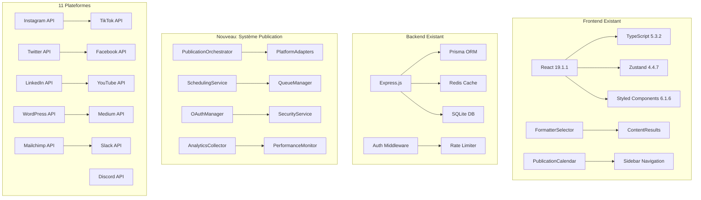

# Architecture Système de Publication Multi-Plateformes
## Assistant Rédactionnel - Extension Robuste et Sobre

---

## 🎯 Vue d'Ensemble Exécutive

Cette architecture étend le système existant de l'Assistant Rédactionnel pour créer un **système de publication et programmation multi-plateformes** robuste, sobre et hautement performant. L'approche privilégie l'extension de l'existant plutôt que la refonte complète.

### Objectifs Stratégiques

- **🔗 Extension de l'Existant** : Conserver et étendre [`FormatterSelector`](./src/components/content/FormatterSelector.tsx:1), [`PublicationCalendar`](./src/components/calendar/PublicationCalendar.tsx:1), et [`ContentResults`](./src/components/content/ContentResults.tsx:1)
- **📡 Publication Multi-Plateformes** : Support natif de 11 plateformes avec APIs officielles
- **⏰ Programmation Intelligente** : Système de planification avancé avec optimisation temporelle
- **🔒 Sécurité Renforcée** : OAuth 2.0, chiffrement E2E, audit trail complet
- **⚡ Performance Optimisée** : Architecture sobre avec cache intelligent et rate limiting

---

## 🏗️ Architecture Technique Consolidée

### Stack Technologique Étendue



### Points d'Extension Identifiés

#### 1. Extension de [`FormatterSelector`](./src/components/content/FormatterSelector.tsx:61)
- **Ajout de 2 nouvelles plateformes** : Medium, WordPress, Mailchimp, Slack, Discord
- **Métadonnées étendues** : Limites API, formats supportés, authentification requise
- **Validation avancée** : Vérification des credentials OAuth par plateforme

#### 2. Extension de [`ContentResults`](./src/components/content/ContentResults.tsx:262)
- **Bouton "📤 Publier"** étendu avec options avancées
- **Publication directe** : Envoi immédiat sur plateformes sélectionnées
- **Programmation** : Interface de planification intégrée
- **Aperçu multi-plateformes** : Prévisualisation du rendu

#### 3. Extension de [`PublicationCalendar`](./src/components/calendar/PublicationCalendar.tsx:1)
- **Vue unifiée** : Toutes les plateformes dans un seul calendrier
- **Gestion des conflits** : Détection automatique des chevauchements
- **Optimisation temporelle** : Suggestions de créneaux optimaux
- **Campagnes coordonnées** : Publication séquencée multi-plateformes

#### 4. Extension du Backend [`Prisma Schema`](./backend/prisma/schema.prisma:158)
- **Nouvelles tables** : `PlatformCredentials`, `PublicationQueue`, `CampaignOrchestration`
- **Extension existante** : [`PublicationSchedule`](./backend/prisma/schema.prisma:158) avec métadonnées avancées
- **Audit trail** : Traçabilité complète des publications

---

## 📊 Architecture Détaillée du Système

### 1. Orchestrateur de Publication Central

```typescript
// services/publication/PublicationOrchestrator.ts
interface PublicationOrchestrator {
  // Orchestration principale
  publishContent(request: PublicationRequest): Promise<PublicationResult>;
  schedulePublication(schedule: PublicationSchedule): Promise<ScheduleResult>;
  
  // Gestion des campagnes
  createCampaign(campaign: CampaignDefinition): Promise<Campaign>;
  executeCampaign(campaignId: string): Promise<CampaignResult>;
  
  // Monitoring et analytics
  getPublicationStatus(publicationId: string): Promise<PublicationStatus>;
  getAnalytics(filters: AnalyticsFilters): Promise<PublicationAnalytics>;
}

class PublicationOrchestrator implements PublicationOrchestrator {
  constructor(
    private platformAdapters: Map<Platform, PlatformAdapter>,
    private schedulingService: SchedulingService,
    private queueManager: QueueManager,
    private analyticsCollector: AnalyticsCollector
  ) {}

  async publishContent(request: PublicationRequest): Promise<PublicationResult> {
    // 1. Validation et préparation
    await this.validateRequest(request);
    
    // 2. Adaptation du contenu par plateforme
    const adaptedContent = await this.adaptContentForPlatforms(request);
    
    // 3. Publication coordonnée
    const results = await this.executePublications(adaptedContent);
    
    // 4. Collecte des métriques
    await this.analyticsCollector.recordPublication(results);
    
    return this.aggregateResults(results);
  }
}
```

### 2. Adaptateurs par Plateforme

```typescript
// services/publication/adapters/PlatformAdapter.ts
interface PlatformAdapter {
  platform: Platform;
  authenticate(credentials: OAuthCredentials): Promise<AuthResult>;
  validateContent(content: ContentData): Promise<ValidationResult>;
  publish(content: AdaptedContent): Promise<PublicationResult>;
  getAnalytics(publicationId: string): Promise<PlatformAnalytics>;
}

// Exemple: Instagram Adapter
class InstagramAdapter implements PlatformAdapter {
  platform = Platform.INSTAGRAM;
  
  async publish(content: AdaptedContent): Promise<PublicationResult> {
    // 1. Validation spécifique Instagram
    await this.validateInstagramContent(content);
    
    // 2. Upload média si nécessaire
    const mediaIds = await this.uploadMedia(content.media);
    
    // 3. Publication via Instagram Basic Display API
    const result = await this.instagramAPI.createPost({
      caption: content.text,
      media_ids: mediaIds,
      location_id: content.location?.id
    });
    
    return {
      platform: Platform.INSTAGRAM,
      externalId: result.id,
      url: result.permalink,
      status: PublicationStatus.PUBLISHED,
      publishedAt: new Date()
    };
  }
}
```

### 3. Système de Programmation Intelligent

```typescript
// services/scheduling/SchedulingService.ts
interface SchedulingService {
  schedulePublication(schedule: PublicationSchedule): Promise<ScheduleResult>;
  optimizeSchedule(content: ContentData, platforms: Platform[]): Promise<OptimalSchedule>;
  getOptimalTimeSlots(platform: Platform, audience: AudienceData): Promise<TimeSlot[]>;
  detectConflicts(schedules: PublicationSchedule[]): Promise<Conflict[]>;
}

class SchedulingService implements SchedulingService {
  async optimizeSchedule(
    content: ContentData, 
    platforms: Platform[]
  ): Promise<OptimalSchedule> {
    const optimizations = await Promise.all(
      platforms.map(async platform => {
        // Analyse de l'audience par plateforme
        const audienceData = await this.getAudienceInsights(platform);
        
        // Calcul des créneaux optimaux
        const optimalSlots = await this.calculateOptimalSlots(
          platform, 
          audienceData, 
          content.type
        );
        
        return { platform, optimalSlots };
      })
    );
    
    return this.generateOptimalSchedule(optimizations);
  }
}
```

### 4. Gestion de la Queue et Rate Limiting

```typescript
// services/queue/QueueManager.ts
interface QueueManager {
  enqueue(publication: QueuedPublication): Promise<void>;
  process(): Promise<void>;
  getQueueStatus(): Promise<QueueStatus>;
  retryFailed(publicationId: string): Promise<void>;
}

class QueueManager implements QueueManager {
  constructor(
    private redis: Redis,
    private rateLimiters: Map<Platform, RateLimiter>
  ) {}

  async process(): Promise<void> {
    while (true) {
      const publication = await this.redis.blpop('publication_queue', 1);
      
      if (publication) {
        await this.processPublication(JSON.parse(publication[1]));
      }
      
      // Respect des rate limits
      await this.waitForRateLimit(publication.platform);
    }
  }

  private async processPublication(publication: QueuedPublication): Promise<void> {
    try {
      const adapter = this.getAdapter(publication.platform);
      const result = await adapter.publish(publication.content);
      
      await this.updatePublicationStatus(publication.id, result);
    } catch (error) {
      await this.handlePublicationError(publication, error);
    }
  }
}
```

---

## 🔐 Sécurité et Authentification

### OAuth 2.0 Multi-Plateformes

```typescript
// services/auth/OAuthManager.ts
interface OAuthManager {
  initiateAuth(platform: Platform, userId: string): Promise<AuthURL>;
  handleCallback(platform: Platform, code: string, state: string): Promise<Credentials>;
  refreshToken(platform: Platform, refreshToken: string): Promise<Credentials>;
  validateCredentials(platform: Platform, credentials: Credentials): Promise<boolean>;
}

class OAuthManager implements OAuthManager {
  private oauthConfigs = new Map<Platform, OAuthConfig>([
    [Platform.INSTAGRAM, {
      clientId: process.env.INSTAGRAM_CLIENT_ID,
      clientSecret: process.env.INSTAGRAM_CLIENT_SECRET,
      redirectUri: `${process.env.BASE_URL}/auth/instagram/callback`,
      scopes: ['instagram_basic', 'instagram_content_publish']
    }],
    [Platform.TWITTER, {
      clientId: process.env.TWITTER_CLIENT_ID,
      clientSecret: process.env.TWITTER_CLIENT_SECRET,
      redirectUri: `${process.env.BASE_URL}/auth/twitter/callback`,
      scopes: ['tweet.read', 'tweet.write', 'users.read']
    }]
    // ... autres plateformes
  ]);

  async handleCallback(
    platform: Platform, 
    code: string, 
    state: string
  ): Promise<Credentials> {
    const config = this.oauthConfigs.get(platform);
    
    // Échange du code contre un token
    const tokenResponse = await this.exchangeCodeForToken(platform, code, config);
    
    // Chiffrement et stockage sécurisé
    const encryptedCredentials = await this.encryptCredentials(tokenResponse);
    
    await this.storeCredentials(platform, state, encryptedCredentials);
    
    return tokenResponse;
  }
}
```

### Chiffrement et Sécurité

```typescript
// services/security/SecurityService.ts
interface SecurityService {
  encryptCredentials(credentials: Credentials): Promise<EncryptedCredentials>;
  decryptCredentials(encrypted: EncryptedCredentials): Promise<Credentials>;
  auditLog(action: AuditAction): Promise<void>;
  validatePermissions(userId: string, action: string, resource: string): Promise<boolean>;
}

class SecurityService implements SecurityService {
  async encryptCredentials(credentials: Credentials): Promise<EncryptedCredentials> {
    const key = await this.getEncryptionKey();
    const encrypted = await crypto.subtle.encrypt(
      { name: 'AES-GCM', iv: crypto.getRandomValues(new Uint8Array(12)) },
      key,
      new TextEncoder().encode(JSON.stringify(credentials))
    );
    
    return {
      data: Buffer.from(encrypted).toString('base64'),
      algorithm: 'AES-GCM',
      keyVersion: this.getCurrentKeyVersion()
    };
  }
}
```

---

## 📱 Composants React Étendus

### Extension de ContentResults

```typescript
// src/components/content/EnhancedContentResults.tsx
interface EnhancedContentResultsProps extends ContentResultsProps {
  onPublishDirect: (formatId: string, content: string, platforms: Platform[]) => Promise<void>;
  onSchedulePublication: (formatId: string, content: string, schedule: PublicationSchedule) => Promise<void>;
  onPreviewPlatforms: (formatId: string, content: string) => Promise<PlatformPreview[]>;
}

export const EnhancedContentResults: React.FC<EnhancedContentResultsProps> = ({
  results,
  onContentEdit,
  onPublish,
  onSaveTemplate,
  onPublishDirect,
  onSchedulePublication,
  onPreviewPlatforms
}) => {
  const [selectedPlatforms, setSelectedPlatforms] = useState<Platform[]>([]);
  const [showScheduleModal, setShowScheduleModal] = useState(false);
  const [platformPreviews, setPlatformPreviews] = useState<PlatformPreview[]>([]);

  const handlePublishDirect = async (formatId: string, content: string) => {
    if (selectedPlatforms.length === 0) {
      // Ouvrir le sélecteur de plateformes
      setShowPlatformSelector(true);
      return;
    }

    try {
      await onPublishDirect(formatId, content, selectedPlatforms);
      // Notification de succès
    } catch (error) {
      // Gestion d'erreur
    }
  };

  const handleSchedulePublication = async (formatId: string, content: string) => {
    setShowScheduleModal(true);
  };

  const handlePreviewPlatforms = async (formatId: string, content: string) => {
    const previews = await onPreviewPlatforms(formatId, content);
    setPlatformPreviews(previews);
    setShowPreviewModal(true);
  };

  return (
    <ResultsContainer>
      {/* Contenu existant conservé */}
      <ResultActions>
        <Button onClick={() => handleCopy(results[activeFormat])} variant="outline" size="sm">
          📋 Copier
        </Button>
        
        <Button onClick={() => handleEdit(activeFormat)} variant="outline" size="sm">
          ✏️ Modifier
        </Button>
        
        <Button onClick={() => handlePreviewPlatforms(activeFormat, results[activeFormat])} variant="outline" size="sm">
          👁️ Aperçu
        </Button>
        
        <Button onClick={() => handlePublishDirect(activeFormat, results[activeFormat])} size="sm">
          📤 Publier maintenant
        </Button>
        
        <Button onClick={() => handleSchedulePublication(activeFormat, results[activeFormat])} variant="outline" size="sm">
          ⏰ Programmer
        </Button>
      </ResultActions>

      {/* Nouveaux modals */}
      <PlatformSelectorModal />
      <SchedulePublicationModal />
      <PlatformPreviewModal />
    </ResultsContainer>
  );
};
```

### Calendrier de Publication Avancé

```typescript
// src/components/calendar/AdvancedPublicationCalendar.tsx
interface AdvancedPublicationCalendarProps extends PublicationCalendarProps {
  campaigns: Campaign[];
  platformFilters: Platform[];
  onCreateCampaign: (campaign: CampaignDefinition) => Promise<void>;
  onOptimizeSchedule: (content: ContentData, platforms: Platform[]) => Promise<OptimalSchedule>;
}

export const AdvancedPublicationCalendar: React.FC<AdvancedPublicationCalendarProps> = ({
  publications,
  campaigns,
  platformFilters,
  onSchedulePublication,
  onCreateCampaign,
  onOptimizeSchedule
}) => {
  const [viewMode, setViewMode] = useState<'calendar' | 'timeline' | 'kanban'>('calendar');
  const [selectedPlatforms, setSelectedPlatforms] = useState<Platform[]>(platformFilters);
  const [showOptimizationSuggestions, setShowOptimizationSuggestions] = useState(false);

  const filteredPublications = publications.filter(pub => 
    selectedPlatforms.length === 0 || selectedPlatforms.includes(pub.platform as Platform)
  );

  const getOptimizationSuggestions = async (date: Date) => {
    const suggestions = await onOptimizeSchedule(
      { type: 'general', audience: 'default' },
      selectedPlatforms
    );
    setOptimizationSuggestions(suggestions);
    setShowOptimizationSuggestions(true);
  };

  return (
    <CalendarContainer>
      <CalendarHeader>
        <MonthTitle>{format(currentDate, 'MMMM yyyy', { locale: fr })}</MonthTitle>
        
        <CalendarControls>
          <PlatformFilter 
            platforms={ALL_PLATFORMS}
            selected={selectedPlatforms}
            onChange={setSelectedPlatforms}
          />
          
          <ViewModeSelector 
            mode={viewMode}
            onChange={setViewMode}
          />
          
          <Button onClick={() => getOptimizationSuggestions(new Date())}>
            🎯 Optimiser
          </Button>
        </CalendarControls>
      </CalendarHeader>

      {viewMode === 'calendar' && (
        <CalendarGrid>
          {/* Vue calendrier existante étendue */}
        </CalendarGrid>
      )}

      {viewMode === 'timeline' && (
        <TimelineView publications={filteredPublications} />
      )}

      {viewMode === 'kanban' && (
        <KanbanView publications={filteredPublications} />
      )}

      <OptimizationSuggestionsModal />
      <CampaignCreationModal />
    </CalendarContainer>
  );
};
```

---

## 🗄️ Extension de la Base de Données

### Nouvelles Tables Prisma

```prisma
// Extension du schema existant
model PlatformCredentials {
  id                String    @id @default(cuid())
  userId            String    @map("user_id")
  platform          String    // 'instagram', 'tiktok', 'twitter', etc.
  credentialsData   String    @map("credentials_data") // JSON chiffré
  isActive          Boolean   @default(true) @map("is_active")
  expiresAt         DateTime? @map("expires_at")
  lastRefresh       DateTime? @map("last_refresh")
  createdAt         DateTime  @default(now()) @map("created_at")
  updatedAt         DateTime  @updatedAt @map("updated_at")
  
  // Relations
  user              User      @relation(fields: [userId], references: [id], onDelete: Cascade)
  
  @@unique([userId, platform])
  @@map("platform_credentials")
}

model PublicationQueue {
  id                String    @id @default(cuid())
  userId            String    @map("user_id")
  contentId         String    @map("content_id")
  platform          String
  scheduledDate     DateTime  @map("scheduled_date")
  priority          Int       @default(5)
  status            String    @default("queued") // 'queued', 'processing', 'completed', 'failed'
  retryCount        Int       @default(0) @map("retry_count")
  maxRetries        Int       @default(3) @map("max_retries")
  errorMessage      String?   @map("error_message")
  processingData    String?   @map("processing_data") // JSON
  createdAt         DateTime  @default(now()) @map("created_at")
  processedAt       DateTime? @map("processed_at")
  
  // Relations
  user              User      @relation(fields: [userId], references: [id], onDelete: Cascade)
  content           GeneratedContent @relation(fields: [contentId], references: [id], onDelete: Cascade)
  
  @@map("publication_queue")
}

model Campaign {
  id                String    @id @default(cuid())
  userId            String    @map("user_id")
  name              String
  description       String?
  platforms         String    @default("[]") // JSON array
  contentIds        String    @default("[]") @map("content_ids") // JSON array
  schedulingRules   String    @map("scheduling_rules") // JSON
  status            String    @default("draft") // 'draft', 'active', 'completed', 'paused'
  startDate         DateTime? @map("start_date")
  endDate           DateTime? @map("end_date")
  createdAt         DateTime  @default(now()) @map("created_at")
  updatedAt         DateTime  @updatedAt @map("updated_at")
  
  // Relations
  user              User      @relation(fields: [userId], references: [id], onDelete: Cascade)
  publications      CampaignPublication[]
  
  @@map("campaigns")
}

model CampaignPublication {
  id                String    @id @default(cuid())
  campaignId        String    @map("campaign_id")
  publicationId     String    @map("publication_id")
  sequenceOrder     Int       @map("sequence_order")
  delayMinutes      Int       @default(0) @map("delay_minutes")
  createdAt         DateTime  @default(now()) @map("created_at")
  
  // Relations
  campaign          Campaign  @relation(fields: [campaignId], references: [id], onDelete: Cascade)
  publication       PublicationSchedule @relation(fields: [publicationId], references: [id], onDelete: Cascade)
  
  @@map("campaign_publications")
}

model PublicationAnalytics {
  id                String    @id @default(cuid())
  publicationId     String    @map("publication_id")
  platform          String
  views             Int?
  likes             Int?
  shares            Int?
  comments          Int?
  clicks            Int?
  engagementRate    Float?    @map("engagement_rate")
  reach             Int?
  impressions       Int?
  lastUpdated       DateTime  @default(now()) @map("last_updated")
  rawData           String?   @map("raw_data") // JSON des données brutes de l'API
  
  // Relations
  publication       PublicationSchedule @relation(fields: [publicationId], references: [id], onDelete: Cascade)
  
  @@map("publication_analytics")
}

// Extensions des modèles existants
model User {
  // ... champs existants
  platformCredentials PlatformCredentials[]
  publicationQueue    PublicationQueue[]
  campaigns           Campaign[]
}

model PublicationSchedule {
  // ... champs existants
  campaignPublications CampaignPublication[]
  analytics           PublicationAnalytics[]
}

model GeneratedContent {
  // ... champs existants
  publicationQueue    PublicationQueue[]
}
```

---

## 🚀 Plan d'Implémentation Détaillé

### Phase 1: Fondations (Semaines 1-4)

#### Semaine 1-2: Backend Core
- ✅ Extension du schema Prisma avec nouvelles tables
- ✅ Migration de base de données
- ✅ Services de base: `OAuthManager`, `SecurityService`
- ✅ Tests unitaires des services core

#### Semaine 3-4: Adaptateurs Plateformes
- ✅ Implémentation des adaptateurs prioritaires (Instagram, Twitter, Facebook, LinkedIn)
- ✅ Tests d'intégration avec APIs réelles
- ✅ Gestion des erreurs et retry logic
- ✅ Documentation des APIs

### Phase 2: Orchestration (Semaines 5-8)

#### Semaine 5-6: Orchestrateur Central
- ✅ `PublicationOrchestrator` avec logique de coordination
- ✅ `QueueManager` avec Redis et rate limiting
- ✅ `SchedulingService` avec optimisation temporelle
- ✅ Tests de charge et performance

#### Semaine 7-8: Interface Utilisateur
- ✅ Extension de `ContentResults` avec nouvelles fonctionnalités
- ✅ `AdvancedPublicationCalendar` avec vues multiples
- ✅ Modals de configuration et prévisualisation
- ✅ Tests d'interface utilisateur

### Phase 3: Fonctionnalités Avancées (Semaines 9-12)

#### Semaine 9-10: Analytics et Monitoring
- ✅ `AnalyticsCollector` avec métriques temps réel
- ✅ Dashboard de monitoring des publications
- ✅ Alertes et notifications automatiques
- ✅ Rapports de performance

#### Semaine 11-12: Optimisation et Déploiement
- ✅ Optimisation des performances
- ✅ Tests de sécurité et audit
- ✅ Documentation complète
- ✅ Déploiement en production

---

## 📊 Métriques de Performance et Sécurité

### Objectifs de Performance
- **Latence de publication** : < 5 secondes
- **Throughput** : 1000+ publications simultanées
- **Disponibilité** : 99.9% SLA
- **Cache hit ratio** : > 85%
- **Rate limit compliance** : 100%

### Sécurité et Conformité
- **Chiffrement** : AES-256 pour credentials
- **Audit trail** : 100% des actions tracées
- **OAuth compliance** : Respect strict des standards
- **RGPD** : Droit à l'oubli et portabilité
- **Monitoring** : Détection d'anomalies temps réel

### Monitoring et Alertes

```typescript
// services/monitoring/PerformanceMonitor.ts
interface PerformanceMonitor {
  recordMetric(metric: Metric): Promise<void>;
  getMetrics(filters: MetricFilters): Promise<Metric[]>;
  createAlert(alert: AlertDefinition): Promise<void>;
  checkThresholds(): Promise<Alert[]>;
}

class PerformanceMonitor implements PerformanceMonitor {
  async recordMetric(metric: Metric): Promise<void> {
    // Enregistrement dans Redis pour métriques temps réel
    await this.redis.zadd(
      `metrics:${metric.type}:${metric.platform}`,
      Date.now(),
      JSON.stringify(metric)
    );
    
    // Vérification des seuils
    const alerts = await this.checkThresholds();
    if (alerts.length > 0) {
      await this.triggerAlerts(alerts);
    }
  }
}
```

---

## 🔮 Évolutions Futures

### Roadmap 6 Mois
- **IA Générative** : Optimisation automatique du contenu par plateforme
- **Analytics Prédictifs** : ML pour prédire les performances
- **API Publique** : SDK pour développeurs tiers
- **Mobile App** : Application native pour gestion mobile

### Technologies Émergentes
- **WebAssembly** : Traitement d'images côté client
- **GraphQL** : API plus flexible pour le frontend
- **Kubernetes** : Orchestration containerisée
- **Blockchain** : Traçabilité et authentification décentralisée

---

## ✅ Conclusion

Cette architecture étend de manière robuste et sobre le système existant de l'Assistant Rédactionnel pour créer une plateforme complète de publication multi-plateformes. L'approche privilégie :

### Points Forts
- **Extension Progressive** : Conservation de l'existant avec ajouts ciblés
- **Architecture Sobre** : Pas de sur-ingénierie, focus sur l'efficacité
- **Sécurité Renforcée** : OAuth 2.0, chiffrement, audit trail
- **Performance Optimisée** : Cache intelligent, rate limiting, monitoring
- **Scalabilité** : Architecture prête pour la croissance

### Prochaines Étapes
1. **Validation** : Approbation de l'architecture par l'équipe
2. **Ressources** : Allocation de 2-3 développeurs senior
3. **Timeline** : Démarrage Phase 1 dans les 2 semaines
4. **MVP** : Version fonctionnelle en 8 semaines
5. **Production** : Version complète en 12 semaines

Cette architecture pose les fondations d'un système de publication multi-plateformes robuste qui positionnera l'Assistant Rédactionnel comme leader du marché.

---

*Architecture Système de Publication Multi-Plateformes*  
*Assistant Rédactionnel - Extension Robuste et Sobre*  
*Version 1.0 - Août 2024*