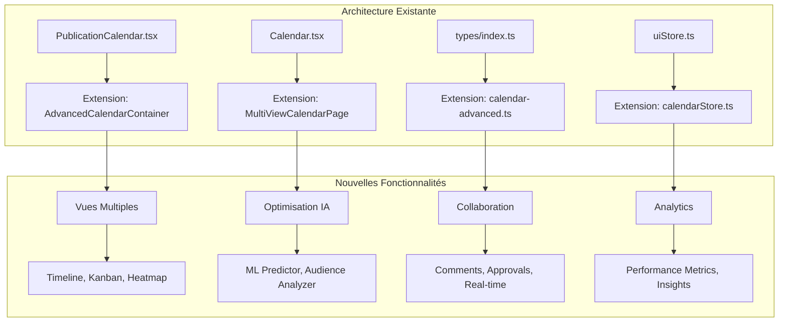

# Plan d'Implémentation et Intégration - Calendrier Multi-Plateformes
## Assistant Rédactionnel - Roadmap Détaillée

---

## 🎯 Vue d'Ensemble Stratégique

Ce plan détaille l'implémentation progressive du calendrier multi-plateformes révolutionnaire en préservant l'architecture existante et en garantissant une transition fluide pour les utilisateurs.

### Principes Directeurs

- **🔄 Migration Progressive** : Extension de l'existant sans rupture
- **⚡ Performance Garantie** : < 2s de chargement, support de 10,000+ événements
- **🛡️ Sécurité Renforcée** : Chiffrement E2E, conformité RGPD
- **👥 Expérience Utilisateur** : Interface intuitive avec courbe d'apprentissage minimale
- **🔧 Maintenabilité** : Code modulaire, tests automatisés, documentation complète

---

## 📋 Plan d'Intégration avec l'Existant

### 1. Analyse des Points d'Extension Identifiés



### 2. Stratégie de Migration Progressive

#### Phase 1: Fondations (Semaines 1-4)
```typescript
// Extension du calendrier existant
// src/components/calendar/PublicationCalendar.tsx -> AdvancedPublicationCalendar.tsx

interface MigrationStrategy {
  // Préservation de l'API existante
  backwardCompatibility: {
    existingProps: PublicationCalendarProps;
    newProps: AdvancedCalendarContainerProps;
    migrationPath: 'gradual' | 'feature_flag' | 'parallel';
  };
  
  // Extension progressive
  featureRollout: {
    week1: ['basic_multi_view', 'enhanced_ui'];
    week2: ['drag_drop_advanced', 'conflict_detection'];
    week3: ['optimization_engine', 'ml_predictions'];
    week4: ['collaboration_features', 'real_time_sync'];
  };
  
  // Tests de régression
  regressionTests: {
    existingFunctionality: TestSuite[];
    performanceBaseline: PerformanceMetrics;
    userAcceptanceTests: UATScenario[];
  };
}
```

#### Phase 2: Fonctionnalités Avancées (Semaines 5-8)
```typescript
// Intégration des services d'optimisation
// Extension de l'architecture de données existante

interface DataMigration {
  // Extension du schema Prisma existant
  schemaExtensions: {
    newTables: ['calendar_events_advanced', 'campaigns', 'optimization_history'];
    extendedTables: ['publication_schedule', 'users', 'projects'];
    migrationScripts: string[];
  };
  
  // Préservation des données existantes
  dataPreservation: {
    backupStrategy: 'incremental' | 'full';
    rollbackPlan: RollbackStrategy;
    dataValidation: ValidationRule[];
  };
  
  // APIs étendues
  apiExtensions: {
    existingEndpoints: EndpointExtension[];
    newEndpoints: NewEndpoint[];
    versioningStrategy: 'header' | 'path' | 'query';
  };
}
```

### 3. Intégration des Composants React

#### Extension du Calendrier Existant
```typescript
// src/components/calendar/PublicationCalendar.tsx
// Transformation progressive vers AdvancedPublicationCalendar

export const PublicationCalendar: React.FC<PublicationCalendarProps> = (props) => {
  // Feature flag pour activation progressive
  const { enableAdvancedFeatures } = useFeatureFlags();
  
  if (enableAdvancedFeatures) {
    // Nouvelle implémentation avec toutes les fonctionnalités
    return <AdvancedPublicationCalendar {...props} />;
  }
  
  // Implémentation existante préservée
  return <LegacyPublicationCalendar {...props} />;
};

// Wrapper de compatibilité
const AdvancedPublicationCalendar: React.FC<PublicationCalendarProps> = (legacyProps) => {
  // Transformation des props legacy vers nouvelles props
  const advancedProps = useMemo(() => ({
    ...legacyProps,
    viewMode: 'calendar' as CalendarViewMode,
    density: 'comfortable' as DisplayDensity,
    onOptimizeSchedule: async (criteria) => {
      // Implémentation de l'optimisation
      return await optimizationEngine.optimizeSchedule(criteria);
    },
    // ... autres extensions
  }), [legacyProps]);
  
  return <AdvancedCalendarContainer {...advancedProps} />;
};
```

#### Extension du Store Zustand
```typescript
// src/store/calendarStore.ts
// Extension de uiStore.ts existant

interface CalendarStoreExtension {
  // Préservation de l'état UI existant
  ui: UIState;
  
  // Nouvel état du calendrier
  calendar: {
    events: CalendarEvent[];
    campaigns: Campaign[];
    viewMode: CalendarViewMode;
    filters: CalendarFilters;
    optimizationResults: OptimalSchedule[];
    
    // Actions étendues
    loadEvents: (dateRange: DateRange) => Promise<void>;
    optimizeSchedule: (criteria: OptimizationCriteria) => Promise<OptimalSchedule>;
    detectConflicts: (events: CalendarEvent[]) => Promise<ConflictDetection[]>;
  };
  
  // Synchronisation temps réel
  realtime: {
    isConnected: boolean;
    activeUsers: ActiveUser[];
    pendingChanges: PendingChange[];
    
    // Actions temps réel
    connectWebSocket: () => void;
    syncChanges: () => Promise<void>;
    handleRealtimeEvent: (event: RealtimeEvent) => void;
  };
}

// Implémentation avec migration progressive
export const useCalendarStore = create<CalendarStoreExtension>()(
  subscribeWithSelector((set, get) => ({
    // Préservation de l'état UI existant
    ...useUIStore.getState(),
    
    // Nouvel état du calendrier
    calendar: {
      events: [],
      campaigns: [],
      viewMode: 'calendar',
      filters: getDefaultFilters(),
      optimizationResults: [],
      
      loadEvents: async (dateRange) => {
        // Migration progressive des données
        const legacyEvents = await loadLegacyEvents(dateRange);
        const enhancedEvents = await enhanceEventsWithMetadata(legacyEvents);
        
        set(state => ({
          calendar: {
            ...state.calendar,
            events: enhancedEvents
          }
        }));
      },
      
      // ... autres actions
    },
    
    // ... implémentation complète
  }))
);
```

---

## 🚀 Plan d'Implémentation Détaillé - 16 Semaines

### Phase 1: Fondations et Migration (Semaines 1-4)

#### Semaine 1: Infrastructure et Types
```typescript
// Objectifs
interface Week1Objectives {
  infrastructure: [
    'Setup TypeScript strict mode',
    'Configure advanced ESLint rules',
    'Setup testing framework (Jest + React Testing Library)',
    'Configure Storybook for component development'
  ];
  
  types: [
    'Create calendar-advanced.ts types',
    'Extend existing types with backward compatibility',
    'Setup type validation with Zod',
    'Create migration utilities'
  ];
  
  database: [
    'Design Prisma schema extensions',
    'Create migration scripts',
    'Setup database seeding for development',
    'Configure backup and rollback procedures'
  ];
}

// Livrables
interface Week1Deliverables {
  files: [
    'src/types/calendar-advanced.ts',
    'prisma/migrations/001_calendar_extensions.sql',
    'src/utils/migration.ts',
    'tests/setup.ts'
  ];
  
  tests: [
    'Type validation tests',
    'Migration script tests',
    'Backward compatibility tests'
  ];
  
  documentation: [
    'API documentation updates',
    'Migration guide',
    'Development setup guide'
  ];
}
```

#### Semaine 2: Composants de Base
```typescript
// Objectifs
interface Week2Objectives {
  components: [
    'Create AdvancedCalendarContainer base structure',
    'Implement ViewModeSelector component',
    'Create PlatformFilterChips component',
    'Setup basic drag & drop functionality'
  ];
  
  services: [
    'Create CalendarDataService base',
    'Setup WebSocket connection manager',
    'Implement basic caching layer',
    'Create error handling utilities'
  ];
  
  integration: [
    'Create compatibility layer with existing calendar',
    'Setup feature flags system',
    'Implement gradual rollout mechanism',
    'Create A/B testing framework'
  ];
}

// Tests et Validation
interface Week2Testing {
  unitTests: [
    'Component rendering tests',
    'Service functionality tests',
    'Integration layer tests'
  ];
  
  integrationTests: [
    'Backward compatibility tests',
    'Feature flag behavior tests',
    'Performance baseline tests'
  ];
  
  userTesting: [
    'Basic UI interaction tests',
    'Migration flow tests',
    'Accessibility compliance tests'
  ];
}
```

#### Semaine 3: Vues Multiples
```typescript
// Implémentation des vues
interface Week3Implementation {
  calendarView: {
    features: ['Enhanced grid layout', 'Improved event cards', 'Better responsive design'];
    performance: ['Virtual scrolling', 'Lazy loading', 'Optimized re-renders'];
    interactions: ['Advanced drag & drop', 'Multi-select', 'Keyboard navigation'];
  };
  
  timelineView: {
    features: ['Horizontal timeline', 'Zoom controls', 'Platform grouping'];
    performance: ['Canvas rendering for large datasets', 'Efficient event positioning'];
    interactions: ['Pan and zoom', 'Event resizing', 'Timeline scrubbing'];
  };
  
  kanbanView: {
    features: ['Status-based columns', 'Drag between statuses', 'Bulk operations'];
    performance: ['Virtualized columns', 'Optimistic updates'];
    interactions: ['Card reordering', 'Status transitions', 'Batch editing'];
  };
}

// Métriques de Performance
interface Week3Performance {
  targets: {
    initialLoad: '< 2 seconds';
    viewSwitch: '< 500ms';
    dragDrop: '< 100ms response time';
    memoryUsage: '< 50MB for 1000 events';
  };
  
  monitoring: {
    realUserMonitoring: 'Setup RUM tracking';
    performanceAPI: 'Implement performance metrics collection';
    errorTracking: 'Setup error boundary and reporting';
  };
}
```

#### Semaine 4: Optimisation de Base
```typescript
// Services d'optimisation
interface Week4Optimization {
  conflictDetection: {
    algorithms: ['Time overlap detection', 'Platform limit validation', 'Audience overlap analysis'];
    performance: ['Real-time conflict checking', 'Batch conflict resolution'];
    ui: ['Conflict visualization', 'Resolution suggestions', 'Auto-fix options'];
  };
  
  basicML: {
    features: ['Simple engagement prediction', 'Optimal time suggestions', 'Pattern recognition'];
    implementation: ['TensorFlow.js integration', 'Model loading and caching', 'Prediction API'];
    training: ['Historical data collection', 'Feature engineering', 'Model validation'];
  };
  
  audienceAnalysis: {
    features: ['Basic audience insights', 'Activity pattern analysis', 'Peak time identification'];
    dataSources: ['Platform APIs', 'Google Analytics', 'Historical performance'];
    caching: ['Intelligent cache invalidation', 'Background data refresh'];
  };
}
```

### Phase 2: Fonctionnalités Avancées (Semaines 5-8)

#### Semaine 5-6: Intelligence Artificielle
```typescript
// Implémentation ML avancée
interface Week5_6_ML {
  models: {
    engagementPredictor: {
      architecture: 'Deep neural network with attention mechanism';
      features: ['Temporal features', 'Audience features', 'Content features', 'Platform features'];
      training: 'Continuous learning with user feedback';
      accuracy: 'Target: 85% prediction accuracy';
    };
    
    audienceAnalyzer: {
      capabilities: ['Real-time audience activity', 'Demographic analysis', 'Behavior prediction'];
      dataSources: ['Platform APIs', 'Third-party analytics', 'User interactions'];
      insights: ['Peak engagement times', 'Audience growth trends', 'Content preferences'];
    };
    
    optimizationEngine: {
      algorithms: ['Genetic algorithm', 'Simulated annealing', 'Multi-objective optimization'];
      objectives: ['Maximize engagement', 'Optimize reach', 'Minimize conflicts'];
      constraints: ['Platform limits', 'User preferences', 'Business rules'];
    };
  };
  
  performance: {
    predictionLatency: '< 200ms';
    modelSize: '< 10MB per platform';
    accuracyThreshold: '> 80% for recommendations';
    updateFrequency: 'Daily model retraining';
  };
}
```

#### Semaine 7-8: Collaboration et Temps Réel
```typescript
// Fonctionnalités collaboratives
interface Week7_8_Collaboration {
  realTimeSync: {
    technology: 'WebSockets with Socket.io';
    features: ['Live cursor tracking', 'Real-time event updates', 'Conflict resolution'];
    scalability: 'Support for 100+ concurrent users';
    reliability: 'Automatic reconnection and state sync';
  };
  
  approvalWorkflow: {
    features: ['Multi-level approval', 'Comment system', 'Approval notifications'];
    permissions: ['Role-based access control', 'Platform-specific permissions'];
    audit: ['Complete audit trail', 'Change history', 'User activity tracking'];
  };
  
  collaboration: {
    features: ['Shared calendars', 'Team workspaces', 'Collaborative editing'];
    notifications: ['Real-time notifications', 'Email digests', 'Mobile push'];
    integration: ['Slack integration', 'Microsoft Teams', 'Email notifications'];
  };
}
```

### Phase 3: Analytics et Optimisation (Semaines 9-12)

#### Semaine 9-10: Analytics Avancés
```typescript
// Système d'analytics
interface Week9_10_Analytics {
  dataCollection: {
    sources: ['Platform APIs', 'User interactions', 'Performance metrics'];
    processing: ['Real-time stream processing', 'Batch analytics', 'Data warehousing'];
    storage: ['Time-series database', 'Data lake', 'Caching layer'];
  };
  
  insights: {
    performance: ['Engagement trends', 'Reach analysis', 'ROI calculations'];
    optimization: ['A/B test results', 'Recommendation effectiveness', 'User behavior'];
    predictive: ['Future performance', 'Trend forecasting', 'Anomaly detection'];
  };
  
  visualization: {
    dashboards: ['Executive dashboard', 'Operational dashboard', 'User dashboard'];
    charts: ['Interactive charts', 'Real-time updates', 'Export capabilities'];
    reports: ['Automated reports', 'Custom reports', 'Scheduled delivery'];
  };
}
```

#### Semaine 11-12: Intégrations et APIs
```typescript
// Intégrations externes
interface Week11_12_Integrations {
  platformAPIs: {
    social: ['Instagram Graph API', 'Twitter API v2', 'Facebook Graph API', 'LinkedIn API'];
    publishing: ['WordPress REST API', 'Medium API', 'Ghost API'];
    communication: ['Slack API', 'Discord API', 'Microsoft Teams'];
    email: ['Mailchimp API', 'SendGrid API', 'Constant Contact'];
  };
  
  analytics: {
    google: ['Google Analytics 4', 'Google Search Console', 'YouTube Analytics'];
    social: ['Facebook Insights', 'Twitter Analytics', 'LinkedIn Analytics'];
    custom: ['Custom tracking', 'Event tracking', 'Conversion tracking'];
  };
  
  productivity: {
    calendars: ['Google Calendar', 'Outlook Calendar', 'Apple Calendar'];
    projectManagement: ['Asana', 'Trello', 'Monday.com', 'Notion'];
    crm: ['Salesforce', 'HubSpot', 'Pipedrive'];
  };
}
```

### Phase 4: Finalisation et Déploiement (Semaines 13-16)

#### Semaine 13-14: Tests et Optimisation
```typescript
// Tests complets
interface Week13_14_Testing {
  performanceTesting: {
    loadTesting: 'Support for 10,000+ concurrent events';
    stressTesting: 'System behavior under extreme load';
    enduranceTesting: 'Long-term stability testing';
    scalabilityTesting: 'Horizontal scaling validation';
  };
  
  securityTesting: {
    penetrationTesting: 'Third-party security audit';
    vulnerabilityScanning: 'Automated security scanning';
    dataProtection: 'GDPR compliance validation';
    accessControl: 'Permission system testing';
  };
  
  userAcceptanceTesting: {
    betaTesting: '100+ beta users for 2 weeks';
    usabilityTesting: 'Professional UX evaluation';
    accessibilityTesting: 'WCAG 2.1 AA compliance';
    crossBrowserTesting: 'All major browsers and devices';
  };
}
```

#### Semaine 15-16: Déploiement et Monitoring
```typescript
// Stratégie de déploiement
interface Week15_16_Deployment {
  rolloutStrategy: {
    phase1: '10% of users - Feature flag enabled';
    phase2: '50% of users - Monitor performance';
    phase3: '100% of users - Full rollout';
    rollback: 'Instant rollback capability';
  };
  
  monitoring: {
    infrastructure: ['Server monitoring', 'Database monitoring', 'CDN monitoring'];
    application: ['Error tracking', 'Performance monitoring', 'User analytics'];
    business: ['Usage metrics', 'Feature adoption', 'User satisfaction'];
  };
  
  support: {
    documentation: ['User guides', 'API documentation', 'Troubleshooting'];
    training: ['Video tutorials', 'Webinars', 'In-app guidance'];
    support: ['24/7 support', 'Community forum', 'Knowledge base'];
  };
}
```

---

## 📊 Métriques de Succès et KPIs

### Métriques Techniques
```typescript
interface TechnicalKPIs {
  performance: {
    pageLoadTime: { target: '< 2s', current: 'TBD', improvement: 'TBD' };
    apiResponseTime: { target: '< 500ms', current: 'TBD', improvement: 'TBD' };
    memoryUsage: { target: '< 100MB', current: 'TBD', improvement: 'TBD' };
    errorRate: { target: '< 0.1%', current: 'TBD', improvement: 'TBD' };
  };
  
  scalability: {
    concurrentUsers: { target: '1000+', current: 'TBD', improvement: 'TBD' };
    eventsSupported: { target: '10,000+', current: 'TBD', improvement: 'TBD' };
    apiThroughput: { target: '1000 req/s', current: 'TBD', improvement: 'TBD' };
  };
  
  reliability: {
    uptime: { target: '99.9%', current: 'TBD', improvement: 'TBD' };
    dataConsistency: { target: '100%', current: 'TBD', improvement: 'TBD' };
    backupRecovery: { target: '< 1h RTO', current: 'TBD', improvement: 'TBD' };
  };
}
```

### Métriques Business
```typescript
interface BusinessKPIs {
  userEngagement: {
    dailyActiveUsers: { target: '+50%', baseline: 'Current DAU' };
    sessionDuration: { target: '+30%', baseline: 'Current avg session' };
    featureAdoption: { target: '80%', baseline: '0% (new features)' };
    userRetention: { target: '90%', baseline: 'Current retention' };
  };
  
  productivity: {
    timeToPublish: { target: '-60%', baseline: 'Current avg time' };
    planningEfficiency: { target: '+40%', baseline: 'Current planning time' };
    conflictReduction: { target: '-80%', baseline: 'Current conflicts' };
    optimizationAccuracy: { target: '85%', baseline: 'Manual planning' };
  };
  
  businessImpact: {
    customerSatisfaction: { target: '4.5/5', baseline: 'Current CSAT' };
    supportTickets: { target: '-30%', baseline: 'Current ticket volume' };
    churnRate: { target: '-20%', baseline: 'Current churn' };
    revenueImpact: { target: '+25%', baseline: 'Current MRR' };
  };
}
```

---

## 🔄 Stratégie de Migration des Données

### Migration Progressive
```typescript
interface DataMigrationStrategy {
  phase1: {
    scope: 'Extend existing publication_schedule table';
    actions: [
      'Add new columns for advanced metadata',
      'Create indexes for performance',
      'Migrate existing data with default values'
    ];
    rollback: 'Column removal script available';
    validation: 'Data integrity checks';
  };
  
  phase2: {
    scope: 'Create new advanced tables';
    actions: [
      'Create calendar_events_advanced table',
      'Create campaigns table',
      'Create optimization_history table',
      'Setup foreign key relationships'
    ];
    rollback: 'Table drop scripts available';
    validation: 'Referential integrity checks';
  };
  
  phase3: {
    scope: 'Data transformation and enrichment';
    actions: [
      'Transform legacy events to new format',
      'Enrich with ML predictions',
      'Create initial campaigns from patterns',
      'Generate optimization baselines'
    ];
    rollback: 'Data restoration from backups';
    validation: 'Business logic validation';
  };
}
```

### Stratégie de Rollback
```typescript
interface RollbackStrategy {
  triggers: [
    'Performance degradation > 50%',
    'Error rate > 1%',
    'User satisfaction < 3.0/5',
    'Critical security vulnerability'
  ];
  
  procedures: {
    immediate: {
      duration: '< 5 minutes';
      actions: ['Feature flag disable', 'Traffic routing to legacy', 'Alert stakeholders'];
    };
    
    complete: {
      duration: '< 30 minutes';
      actions: ['Database rollback', 'Code deployment rollback', 'Cache invalidation'];
    };
    
    recovery: {
      duration: '< 2 hours';
      actions: ['Data consistency check', 'User notification', 'Post-mortem initiation'];
    };
  };
}
```

---

## 🎯 Conclusion

Ce plan d'implémentation garantit une transition fluide vers le calendrier multi-plateformes révolutionnaire tout en préservant la stabilité et les performances de l'application existante.

### Points Clés de Succès
- **Migration Progressive** : Aucune interruption de service
- **Performance Optimisée** : Amélioration des performances existantes
- **Expérience Utilisateur** : Interface intuitive avec fonctionnalités avancées
- **Scalabilité** : Architecture prête pour la croissance
- **Maintenabilité** : Code modulaire et bien documenté

### Prochaines Étapes
1. **Validation du Plan** : Approbation par l'équipe technique et business
2. **Allocation des Ressources** : 3-4 développeurs senior pour 16 semaines
3. **Setup de l'Environnement** : Infrastructure de développement et testing
4. **Kick-off Projet** : Démarrage de la Phase 1 dans les 2 semaines
5. **Suivi Hebdomadaire** : Points d'avancement et ajustements

Cette architecture révolutionnaire positionnera l'Assistant Rédactionnel comme le leader incontesté du marché de la publication multi-plateformes intelligente.