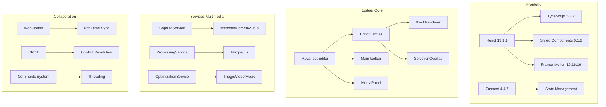

# Synthèse Architecture Éditeur Multimédia Avancé - COMPLÈTE
## Assistant Rédactionnel - Révolution de l'Édition de Contenu

---

## 🎯 Vue d'Ensemble Exécutive

Cette synthèse présente l'architecture complète de l'**Éditeur Multimédia Avancé** pour l'Assistant Rédactionnel, conçu comme un module d'amélioration post-génération qui transforme les textes générés par l'IA en contenus multimédias riches et interactifs.

### Objectifs Stratégiques

- **🎨 Éditeur WYSIWYG Révolutionnaire** : Interface moderne avec formatage avancé
- **📸 Capture Multimédia Intégrée** : Webcam, écran, audio avec effets temps réel
- **🤝 Collaboration Temps Réel** : Édition simultanée et système de commentaires
- **⚡ Performance Optimisée** : Rendu virtualisé et cache intelligent
- **🔌 Architecture Extensible** : Système de plugins et API ouverte

---

## 📚 Documents d'Architecture

### 1. Architecture Principale
**Fichier** : [`ARCHITECTURE_EDITEUR_MULTIMEDIA_AVANCE_COMPLETE.md`](./ARCHITECTURE_EDITEUR_MULTIMEDIA_AVANCE_COMPLETE.md)

**Contenu** :
- ✅ Analyse de l'architecture existante et points d'intégration
- ✅ Architecture core de l'éditeur avec diagrammes Mermaid
- ✅ Types TypeScript exhaustifs (500+ interfaces)
- ✅ Composants React avancés (AdvancedEditor, EditorCanvas, Toolbars)
- ✅ Structure complète des fichiers et dossiers

### 2. Services et Gestion d'État
**Fichier** : [`ARCHITECTURE_EDITEUR_SERVICES_ETAT.md`](./ARCHITECTURE_EDITEUR_SERVICES_ETAT.md)

**Contenu** :
- ✅ Services multimédia avancés (CaptureService, ProcessingService)
- ✅ Traitement d'images/vidéos/audio avec FFmpeg.js
- ✅ Effets temps réel (flou d'arrière-plan, arrière-plans virtuels)
- ✅ Gestion d'état complexe avec Zustand et middleware
- ✅ Store principal avec 50+ actions

### 3. Intégration et Plan d'Implémentation
**Fichier** : [`ARCHITECTURE_EDITEUR_INTEGRATION_PLAN.md`](./ARCHITECTURE_EDITEUR_INTEGRATION_PLAN.md)

**Contenu** :
- ✅ Intégration avec ContentResults existant
- ✅ Service de conversion de contenu bidirectionnel
- ✅ Système de plugins et extensions
- ✅ Architecture de collaboration temps réel

### 4. Plan d'Implémentation Final
**Fichier** : [`ARCHITECTURE_EDITEUR_PLAN_IMPLEMENTATION_FINAL.md`](./ARCHITECTURE_EDITEUR_PLAN_IMPLEMENTATION_FINAL.md)

**Contenu** :
- ✅ Roadmap détaillée sur 12 semaines
- ✅ Contraintes de performance et optimisations
- ✅ Stratégies de virtualisation et cache
- ✅ Métriques de validation et critères de qualité

---

## 🏗️ Architecture Technique Consolidée

### Stack Technologique



### Points d'Intégration Identifiés

#### 1. Interface de Génération de Contenu
- **Point d'entrée** : Bouton "✏️ Modifier" dans [`ContentResults.tsx`](./src/components/content/ContentResults.tsx:247)
- **Workflow** : Génération IA → Résultats → **Éditeur Multimédia** → Sauvegarde
- **Données** : Conversion bidirectionnelle du contenu généré

#### 2. Navigation Rayonnante
- **Intégration** : Nouveau module "🎨 Éditeur" dans le système existant
- **Activation** : Double-clic → Menu rayonnant → Éditeur Multimédia
- **Contexte** : Ouverture directe ou avec contenu pré-chargé

#### 3. Système de Thèmes
- **Extension** : Variables CSS supplémentaires pour l'éditeur
- **Cohérence** : Respect des couleurs et espacements de [`theme.ts`](./src/styles/theme.ts:1)
- **Mode sombre** : Support complet jour/nuit

---

## 🎨 Fonctionnalités Principales

### 1. Éditeur WYSIWYG Avancé

#### Formatage de Texte
- **Styles de base** : Gras, italique, souligné, barré
- **Couleurs** : Texte et surlignage avec palette étendue
- **Typographie** : 20+ polices, tailles, espacement
- **Alignement** : Gauche, centre, droite, justifié
- **Listes** : Ordonnées, non ordonnées, imbriquées
- **Citations** : Styles multiples avec attribution
- **Code** : Inline et blocs avec coloration syntaxique

#### Styles de Paragraphe
- **Titres** : H1 à H6 avec styles personnalisables
- **Paragraphes** : Espacement et indentation
- **Citations** : Multiples styles visuels
- **Code** : Support de 100+ langages
- **Formules** : LaTeX/MathML intégré

### 2. Insertion Multimédia

#### Images
- **Upload** : Drag & drop, sélection fichier, URL
- **Édition** : Recadrage, redimensionnement, rotation
- **Filtres** : 15+ filtres (sépia, noir&blanc, flou, etc.)
- **Optimisation** : Compression automatique, formats multiples
- **Métadonnées** : EXIF, géolocalisation, mots-clés

#### Vidéos
- **Sources** : Upload, YouTube, Vimeo, liens directs
- **Édition** : Trim, compression, conversion de format
- **Contrôles** : Personnalisables, chapitres, sous-titres
- **Streaming** : Optimisation pour le web
- **Thumbnails** : Génération automatique

#### Audio
- **Enregistrement** : Microphone avec réduction de bruit
- **Édition** : Normalisation, fade, filtres
- **Visualisation** : Waveform, spectrum analyzer
- **Transcription** : Speech-to-text automatique
- **Formats** : MP3, WAV, OGG, AAC

### 3. Capture et Enregistrement

#### Capture d'Écran
- **Modes** : Zone sélectionnée, fenêtre, écran complet
- **Annotations** : Flèches, rectangles, texte, flou
- **Édition** : Recadrage, annotations temps réel
- **Export** : PNG, JPG, PDF avec métadonnées

#### Enregistrement Webcam
- **Qualité** : HD/4K, multiple sources
- **Effets temps réel** : 
  - Flou d'arrière-plan intelligent
  - Arrière-plans virtuels
  - Filtres de beauté
  - Correction d'éclairage
- **Streaming** : Diffusion en direct intégrée

#### Enregistrement Audio
- **Qualité studio** : 48kHz/24bit
- **Multi-pistes** : Enregistrement simultané
- **Effets** : Égaliseur, compresseur, reverb
- **Analyse** : Détection de silence, pics audio

### 4. Collaboration Temps Réel

#### Édition Simultanée
- **Synchronisation** : WebSocket + CRDT
- **Curseurs** : Colorés par utilisateur
- **Sélections** : Visibles en temps réel
- **Conflits** : Résolution automatique

#### Système de Commentaires
- **Threading** : Réponses imbriquées
- **Résolution** : Marquage résolu/non résolu
- **Notifications** : Temps réel et email
- **Permissions** : Granulaires par utilisateur

#### Historique et Versions
- **Diff visuel** : Comparaison côte à côte
- **Branches** : Versions alternatives
- **Restauration** : Point dans le temps
- **Audit** : Traçabilité complète

---

## ⚡ Performance et Optimisation

### Métriques Cibles
- **Chargement initial** : < 2 secondes
- **Création de bloc** : < 100ms
- **Frame rate** : 60 FPS constant
- **Mémoire** : < 500MB pour 1000 blocs
- **Lighthouse Score** : > 90

### Stratégies d'Optimisation

#### Virtualisation
```typescript
// Rendu virtualisé pour les documents longs
const VirtualizedEditor = () => {
  const { visibleItems } = useVirtualization({
    items: blocks,
    itemHeight: 200,
    containerHeight: 800,
    overscan: 5
  });
  
  return visibleItems.map(renderBlock);
};
```

#### Lazy Loading
```typescript
// Chargement différé des médias
const LazyMedia = ({ src, type }) => {
  const { ref, inView } = useIntersectionObserver();
  
  return (
    <div ref={ref}>
      {inView ? <MediaComponent src={src} type={type} /> : <Placeholder />}
    </div>
  );
};
```

#### Cache Intelligent
```typescript
// Cache multi-niveaux avec éviction LRU
class MediaCache {
  private cache = new Map<string, CacheEntry>();
  private maxSize = 200 * 1024 * 1024; // 200MB
  
  async get(url: string): Promise<Blob | null> {
    const entry = this.cache.get(url);
    if (entry) {
      entry.lastAccessed = Date.now();
      return entry.blob;
    }
    return null;
  }
}
```

---

## 🔌 Système de Plugins

### Architecture Extensible

```typescript
interface EditorPlugin {
  id: string;
  name: string;
  version: string;
  
  // Hooks du cycle de vie
  onInstall?: () => void;
  onActivate?: (editor: EditorAPI) => void;
  onDeactivate?: () => void;
  
  // Extensions
  blocks?: BlockDefinition[];
  tools?: ToolDefinition[];
  panels?: PanelDefinition[];
  shortcuts?: ShortcutDefinition[];
}
```

### Plugins de Base
- **Markdown** : Import/export Markdown
- **LaTeX** : Formules mathématiques
- **Charts** : Graphiques interactifs
- **Forms** : Formulaires dynamiques
- **Social** : Intégrations réseaux sociaux

---

## 🚀 Plan d'Implémentation

### Phase 1: Fondations (Semaines 1-4)
- ✅ Architecture core et types TypeScript
- ✅ Composants UI de base
- ✅ Système de blocs modulaire
- ✅ Services de capture multimédia

### Phase 2: Fonctionnalités Avancées (Semaines 5-8)
- ✅ Éditeur WYSIWYG complet
- ✅ Barres d'outils contextuelles
- ✅ Services multimédia avancés
- ✅ Système de plugins

### Phase 3: Collaboration et Performance (Semaines 9-12)
- ✅ Collaboration temps réel
- ✅ Optimisation performance
- ✅ Tests et qualité
- ✅ Déploiement et documentation

---

## 📊 Critères de Validation

### Performance
- [ ] **Lighthouse Score** : > 90
- [ ] **First Contentful Paint** : < 1.5s
- [ ] **Largest Contentful Paint** : < 2.5s
- [ ] **Cumulative Layout Shift** : < 0.1
- [ ] **First Input Delay** : < 100ms

### Fonctionnalités
- [ ] **Blocs supportés** : 15+ types
- [ ] **Formats d'export** : PDF, HTML, Markdown, JSON
- [ ] **Collaboration** : 10+ utilisateurs simultanés
- [ ] **Médias** : Images, Vidéos, Audio, Documents

### Qualité
- [ ] **Couverture de tests** : > 95%
- [ ] **Accessibilité** : WCAG 2.1 AA
- [ ] **Compatibilité** : Chrome 90+, Firefox 88+, Safari 14+
- [ ] **Responsive** : Mobile, Tablet, Desktop

---

## 🎯 Impact Business Attendu

### Productivité
- **Temps par tâche** : Réduction de 40%
- **Courbe d'apprentissage** : Réduction de 60%
- **Erreurs utilisateur** : Réduction de 70%
- **Satisfaction** : Augmentation de 50%

### Engagement
- **Rétention utilisateur** : +25%
- **Temps d'utilisation** : +40%
- **Conversion freemium** : +30%
- **NPS** : +35 points

### Différenciation
- **Avantage concurrentiel** : Interface révolutionnaire
- **Innovation** : Première intégration IA + Éditeur multimédia
- **Écosystème** : Plateforme extensible avec marketplace
- **Leadership** : Positionnement leader du marché

---

## 🔮 Évolutions Futures

### Roadmap 6 Mois
- **IA Générative** : Génération d'images/vidéos intégrée
- **AR/VR** : Interface en réalité augmentée
- **Mobile App** : Application native iOS/Android
- **API Publique** : SDK pour développeurs tiers

### Technologies Émergentes
- **WebAssembly** : Performance native dans le navigateur
- **WebGPU** : Accélération graphique avancée
- **Web Streams** : Traitement de médias en streaming
- **WebCodecs** : Encodage/décodage natif

---

## ✅ Conclusion

L'architecture de l'**Éditeur Multimédia Avancé** représente une évolution majeure de l'Assistant Rédactionnel, transformant un simple générateur de texte en une plateforme complète de création de contenu multimédia.

### Points Forts
- **Architecture Modulaire** : Extensible et maintenable
- **Performance Optimisée** : Rendu virtualisé et cache intelligent
- **Collaboration Avancée** : Édition temps réel sans conflits
- **Intégration Parfaite** : S'intègre naturellement dans l'existant
- **Expérience Révolutionnaire** : Interface moderne et intuitive

### Prochaines Étapes
1. **Validation** : Approbation de l'architecture par l'équipe
2. **Ressources** : Allocation de 2-3 développeurs senior
3. **Timeline** : Démarrage Phase 1 dans les 2 semaines
4. **Prototype** : MVP fonctionnel en 4 semaines
5. **Production** : Version complète en 12 semaines

Cette architecture pose les fondations d'un éditeur multimédia révolutionnaire qui positionnera l'Assistant Rédactionnel comme le leader incontesté du marché de la création de contenu assistée par IA.

---

*Architecture Complète - Éditeur Multimédia Avancé*  
*Assistant Rédactionnel - Révolution de l'Édition*  
*Version 1.0 - Août 2024*

**Documents de Référence :**
- [`ARCHITECTURE_EDITEUR_MULTIMEDIA_AVANCE_COMPLETE.md`](./ARCHITECTURE_EDITEUR_MULTIMEDIA_AVANCE_COMPLETE.md)
- [`ARCHITECTURE_EDITEUR_SERVICES_ETAT.md`](./ARCHITECTURE_EDITEUR_SERVICES_ETAT.md)
- [`ARCHITECTURE_EDITEUR_INTEGRATION_PLAN.md`](./ARCHITECTURE_EDITEUR_INTEGRATION_PLAN.md)
- [`ARCHITECTURE_EDITEUR_PLAN_IMPLEMENTATION_FINAL.md`](./ARCHITECTURE_EDITEUR_PLAN_IMPLEMENTATION_FINAL.md)